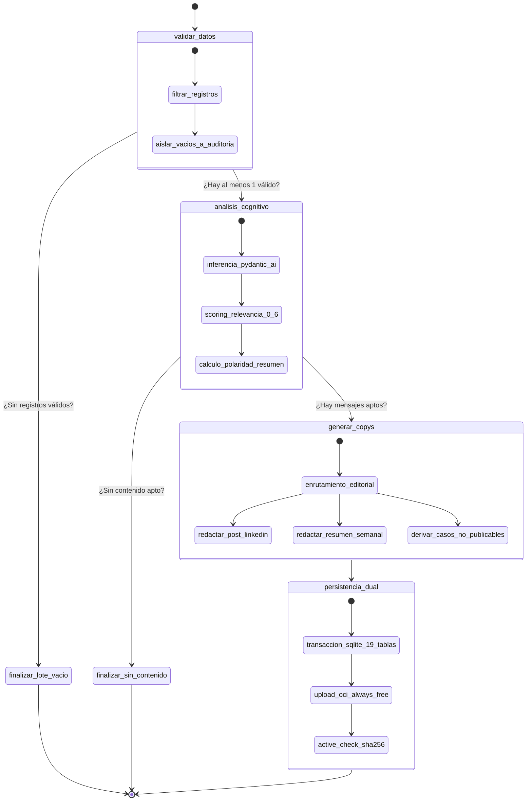

# CommunityLab — Hackathon ONE G10 / No Country · Equipo 34
> **Motor Inteligente de Transformación, Enriquecimiento Cognitivo y Distribución para Comunidades Digitales**  
> *Versión Final Consolidada para el Demo Day — 27 de Octubre de 2026*

---

[](https://www.python.org/)
[](https://docs.astral.sh/uv/)
[](https://fastapi.tiangolo.com/)
[](https://docs.pydantic.dev/)
[](https://ai.pydantic.dev/)
[](https://langchain-ai.github.io/langgraph/)
[](https://streamlit.io/)
[](https://www.oracle.com/cloud/free/)
[-brightgreen?style=for-the-badge&logo=pytest&logoColor=white)](#-8-evidencias-técnicas-y-criterios-de-aceptación)

---

## 📑 Tabla de Contenidos

1. [🎯 1. Descripción General](#-1-descripción-general)
   - [¿Qué es CommunityLab y qué problema resuelve?](#qué-es-communitylab-y-qué-problema-resuelve)
   - [Los 5 Principios Fundamentales No Negociables](#los-5-principios-fundamentales-no-negociables)
2. [🧠 2. Arquitectura de la Solución y Agentes de IA](#-2-arquitectura-de-la-solución-y-agentes-de-ia)
   - [Estructura Interna del Agente y Orquestación con LangGraph](#estructura-interna-del-agente-y-orquestación-con-langgraph)
   - [Inferencia Estructurada Tipada con PydanticAI](#inferencia-estructurada-tipada-con-pydanticai)
   - [Scoring Objetivo de Relevancia (0 a 6 puntos)](#scoring-objetivo-de-relevancia-0-a-6-puntos)
   - [Fábrica Multi-Proveedor y Conmutación en Caliente](#fábrica-multi-proveedor-y-conmutación-en-caliente)
   - [Optimización mediante Prompt Caching y Políticas de Resiliencia](#optimización-mediante-prompt-caching-y-políticas-de-resiliencia)
3. [🗺️ 3. Diagramas de Arquitectura del Pipeline](#️-3-diagramas-de-arquitectura-del-pipeline)
   - [Diagrama de Flujo del Sistema Completo](#diagrama-de-flujo-del-sistema-completo)
   - [Grafo de Estados de LangGraph (Pipeline Cognitivo)](#grafo-de-estados-de-langgraph-pipeline-cognitivo)
   - [Ciclo de Vida de un Lote y Persistencia Dual](#ciclo-de-vida-de-un-lote-y-persistencia-dual)
4. [🛠️ 4. Tecnologías y Herramientas (Stack Tecnológico)](#️-4-tecnologías-y-herramientas-stack-tecnológico)
5. [📁 5. Estructura del Repositorio](#-5-estructura-del-repositorio)
6. [🚀 6. Instrucciones de Uso: Guía Paso a Paso de Despliegue](#-6-instrucciones-de-uso-guía-paso-a-paso-de-despliegue)
   - [Prerrequisitos](#1-prerrequisitos)
   - [Instalación de uv y Clonación](#2-clonación-y-sincronización-del-entorno)
   - [Variables de Entorno](#3-configuración-de-variables-de-entorno)
   - [Ejecución de Pruebas](#4-ejecución-de-la-suite-de-pruebas)
   - [Levantamiento de Servicios Locales (Paso a Paso)](#5-levantamiento-de-servicios-en-desarrollo-local)
   - [Prueba de Punta a Punta (End-to-End)](#6-prueba-de-punta-a-punta-end-to-end)
7. [🖥️ 7. Ejemplos de la Interfaz de Usuario (Frontend en Streamlit)](#️-7-ejemplos-de-la-interfaz-de-usuario-frontend-en-streamlit)
   - [Paso 1: Carga y Validación Inmediata](#paso-1-carga-y-admisión)
   - [Paso 2: Resultados y Dashboard Analítico](#paso-2-resultados-y-dashboard-analítico)
   - [Paso 3: Edición y Aprobación de Copys con Trazabilidad](#paso-3-edición-y-aprobación-de-copys)
   - [Paso 4: Persistencia y Evidencia en Oracle Cloud (OCI)](#paso-4-almacenamiento-y-evidencia-en-oci)
8. [📊 8. Evidencias Técnicas y Criterios de Aceptación](#-8-evidencias-técnicas-y-criterios-de-aceptación)
9. [📚 9. Documentación Técnica del Proyecto](#-9-documentación-técnica-del-proyecto)

---

## 🎯 1. Descripción General

### ¿Qué es CommunityLab y qué problema resuelve?

En comunidades de aprendizaje tecnológico, plataformas SaaS y ecosistemas de desarrolladores (como **Discord, Slack, foros educativos, GitHub y formularios web**), los usuarios comparten diariamente valiosos testimonios de éxito, soluciones a problemas complejos, bloqueos recurrentes y dudas formativas.

Sin embargo, estos mensajes valiosos sufren de un problema común en la industria: **el ruido efímero**. Los mensajes quedan sepultados rápidamente en canales de chat interminables, provocando dos graves ineficiencias:
1. **Pérdida de Conocimiento Colectivo:** Las dudas se repiten una y otra vez porque no se sintetizan en recursos públicos ni resúmenes semanales.
2. **Desaprovechamiento de Casos de Éxito:** Los equipos de gestión de comunidad (*Community Managers*) y marketing no dan abasto para leer cientos de mensajes al día, identificar los logros reales y redactar contenido verídico y atractivo para redes profesionales como **LinkedIn**.

**CommunityLab** es una plataforma desacoplada y orientada a eventos que resuelve este desafío. Captura lotes de interacciones comunitarias no estructuradas, aísla fallos en tiempo de ejecución, ejecuta un análisis cognitivo profundo mediante Inteligencia Artificial estructurada, y **redacta simultáneamente dos formatos de difusión pública**:
* Una **publicación para LinkedIn** con enfoque editorial y hashtags profesionales.
* Un **resumen semanal** que sintetiza el pulso, las tendencias y los aprendizajes del grupo.

Todo esto bajo un flujo de **curaduría humana (*Human-in-the-Loop*)** con interfaz web interactiva y persistencia inmutable en **Oracle Cloud Infrastructure (OCI Always Free)**.

```
┌─────────────────────────┐      ┌─────────────────────────┐      ┌─────────────────────────┐
│   Canales Comunitarios   │ ───> │  Pipeline Cognitivo IA  │ ───> │  Curaduría y Difusión   │
│ (Discord, Slack, Foros) │      │  (LangGraph + Pydantic) │      │ (LinkedIn + Resumen OCI)│
└─────────────────────────┘      └─────────────────────────┘      └─────────────────────────┘
```

---

### Los 5 Principios Fundamentales No Negociables

Para asegurar que el sistema sea confiable, predecible y digno de uso empresarial, el equipo formalizó cinco principios técnicos clave:

1. 🔒 **Política de Cero Hechos Inventados (*Zero Invented Facts*):**  
   Los Modelos de Lenguaje Grande (LLMs) tienden a alucinar nombres, cargos o datos estadísticos cuando se les pide redactar un copy de marketing. En CommunityLab, **ningún texto puede generarse sin asociar de manera obligatoria una lista no vacía de identificadores de mensajes fuente (`source_ids >= 1`)**. Si una afirmación no proviene de un mensaje verificado en la ingesta, el validador de contratos rechaza el paquete automáticamente.
2. 🛡️ **Validación en Dos Capas y Aislamiento de Fallos (Regla R1 / M03):**  
   Imagina que una comunidad envía un lote con 100 mensajes, pero el mensaje número 42 viene sin texto o con una fecha mal formateada. En arquitecturas frágiles, la API arrojaría un error HTTP 422 y descartaría los 100 mensajes. En CommunityLab aplicamos dos capas:
   - *Capa 1 (Admisión perimetral en FastAPI):* Permisiva en tipos (acepta fechas como cadenas de texto) para no tumbar transferencias por fallas menores.
   - *Capa 2 (Pipeline de datos local):* Estricta registro a registro. Los mensajes con texto vacío o corrupto son segregados de inmediato hacia una tabla de auditoría en SQLite (`auditoria_rechazados`), mientras que los 99 mensajes sanos continúan hacia los agentes de IA.
3. ⚖️ **Scoring Objetivo de Relevancia (0 a 6 puntos):**  
   En lugar de pedirle al LLM un número arbitrario ("dime del 1 al 10 qué tan bueno es este mensaje"), obligamos al modelo a calificar **tres dimensiones discretas e independientes (de 0 a 2 puntos)**: evidencia explícita, utilidad comunitaria y claridad de contexto. El total es calculado aritméticamente por código Python, garantizando sumas matemáticas exactas.
4. 📰 **Generación Simultánea de Formatos Base (Regla M01):**  
   El motor detecta el enfoque predominante del lote (`Logro`, `Duda` o `Dificultad`) para calibrar el tono de voz, pero **siempre genera en simultáneo ambos formatos base**: publicación para LinkedIn y resumen semanal, acompañados de los casos no publicables para que el curador humano tenga el panorama completo.
5. ☁️ **Persistencia Inmutable con Verificación Activa en OCI (Regla M07 / R7):**  
   El estado `guardado_con_exito` en Oracle Cloud no se asume ciegamente. Tras ejecutar un `put_object`, el software realiza de inmediato un `get_object` leyendo el archivo remoto byte a byte y verifica que su hash criptográfico **SHA-256** sea exactamente igual al del archivo local. Además, cada edición humana crea una nueva revisión incremental (`revision-001.json`, `revision-002.json`), impidiendo la pérdida accidental de información histórica.

---

## 🧠 2. Arquitectura de la Solución y Agentes de IA

### Estructura Interna del Agente y Orquestación con LangGraph

En sistemas de producción, ejecutar llamadas a LLMs dentro de un script lineal simple es propenso a errores: si una llamada falla, se pierde el estado o es imposible reintentar fases específicas.

CommunityLab implementa una **máquina de estados desacoplada utilizando LangGraph (`StateGraph`)**. Un grafo de estados permite dividir el procesamiento en etapas autónomas llamadas **nodos**, que leen y actualizan un estado inmutable compartido (`PipelineState`).

```
                              ┌──────────────────┐
                              │  validar_datos   │
                              └────────┬─────────┘
                                       │
                      ¿Hay registros   │
                      válidos?         ├───────── NO ─────────> [ finalizar_lote_vacio ]
                                       │
                                      SÍ
                                       ▼
                              ┌──────────────────┐
                              │analisis_cognitivo│
                              └────────┬─────────┘
                                       │
                      ¿Hay contenido   │
                      apto?            ├───────── NO ─────────> [finalizar_sin_contenido]
                                       │
                                      SÍ
                                       ▼
                              ┌──────────────────┐
                              │  generar_copys   │
                              └────────┬─────────┘
                                       │
                                       ▼
                              ┌──────────────────┐
                              │ persistencia_dual│
                              └──────────────────┘
```

#### Los Nodos del Pipeline Explicados:
1. `validar_datos`: Inspecciona cada interacción del lote. Convierte registros válidos en `InteraccionValidada` y desvía registros dañados a la tabla de auditoría (`auditoria_rechazados`). Si el lote completo está vacío, deriva inmediatamente a `finalizar_lote_vacio`.
2. `analisis_cognitivo`: Envía los mensajes sanos al agente cognitivo (PydanticAI). Evalúa sentimiento, clasifica temas y calcula la puntuación de relevancia (0 a 6).
3. `generar_copys`: Un router condicional evalúa si el lote tiene mensajes aptos para difusión pública. Si no los hay, deriva a `finalizar_sin_contenido`. Si los hay, redacta de forma paralela la publicación para LinkedIn y el resumen semanal, preservando la lista de citas (`source_ids`).
4. `persistencia_dual`: Guarda los resultados en una única transacción atómica en SQLite v2 (19 tablas relacionales) y sube el borrador inicial (`revision-001.json`) a Oracle Cloud Infrastructure.

---

### Inferencia Estructurada Tipada con PydanticAI

Los modelos LLM tradicionales generan cadenas de texto libre en Markdown o JSON que frecuentemente sufren de comas faltantes, llaves sin cerrar o tipos de datos incorrectos.

Para solucionar esto, utilizamos **PydanticAI**, que fuerza al modelo a responder exclusivamente a través de los contratos formales definidos en [`esquemas.py`](esquemas.py):

* **`AnalisisCognitivo`:** Garantiza que cada mensaje tenga su sentimiento en 4 clases discretas (`Literal["Altamente Positivo", "Positivo", "Neutro", "Dificultad/Negativo"]`), su categoría de enrutamiento (`Literal["Logro", "Duda", "Dificultad"]`), lista de temas y justificación obligatoria (`motivo_seleccion` con mínimo 10 caracteres).
* **`PaqueteSalida`:** Garantiza la integridad del paquete final que incluye los copys de marketing (`PostLinkedIn`, `ResumenSemanal`), los casos no publicables (`CasoNoPublicable`), los metadatos de latencia y tokens (`MetadatosEjecucion`), el historial de revisión (`EstadoRevision`) y la evidencia en la nube (`EvidenciaAlmacenamientoOCI`).

---

### Scoring Objetivo de Relevancia (0 a 6 puntos)

El modelo de datos [`PuntuacionRelevancia`](esquemas.py) descompone la evaluación en tres preguntas concretas:

$$\text{Puntuación Total} = \text{Evidencia Explícita (0-2)} + \text{Utilidad Comunitaria (0-2)} + \text{Claridad de Contexto (0-2)}$$

| Dimensión | Puntos (0 a 2) | ¿Qué evalúa el agente cognitivo? |
|---|---|---|
| **Evidencia Explícita** | 0 = Vago / Opinión<br>1 = Menciona herramientas<br>2 = Cita datos concretos, métricas o capturas | ¿El mensaje demuestra un logro o problema tangible con hechos comprobables? |
| **Utilidad Comunitaria** | 0 = Interés puramente personal<br>1 = Aporta al canal<br>2 = Resuelve un bloqueo crítico común | ¿Este mensaje le sirve a otros estudiantes o miembros de la comunidad para aprender? |
| **Claridad de Contexto** | 0 = Incomprensible fuera del chat<br>1 = Requiere contexto previo<br>2 = Totalmente autónomo | ¿El mensaje se entiende por sí solo al ser leído en LinkedIn o en un resumen semanal? |

Un decorador `@model_validator(mode="after")` en Python calcula la suma aritmética del campo `total`. Esto impide que el LLM cometa errores matemáticos al sumar los puntos.

---

### Fábrica Multi-Proveedor y Conmutación en Caliente

Ubicada en [`ai_modules/multiprovider_agent.py`](ai_modules/multiprovider_agent.py), la clase `CognitiveAgentFactory` desacopla completamente el código de cualquier proveedor comercial de Inteligencia Artificial.

Mediante la variable de entorno `LLM_PROVIDER`, puedes cambiar el motor de IA en caliente sin tocar una sola línea de código:

```bash
# Cambiar entre proveedores en el archivo .env:
LLM_PROVIDER=openai       # Utiliza gpt-4o-mini (Titular por defecto)
LLM_PROVIDER=gemini       # Utiliza gemini-3.6-flash (Google GenAI)
LLM_PROVIDER=anthropic    # Utiliza claude-haiku-4-5-20251001 (Anthropic)
LLM_PROVIDER=groq         # Utiliza Llama 3 / Mistral sobre endpoints compatibles
LLM_PROVIDER=openrouter   # Utiliza OpenRouter para enrutamiento flexible
```

---

### Optimización mediante Prompt Caching y Políticas de Resiliencia

1. ⚡ **Prompt Caching de Prefijo Nativo:**  
   El catálogo de ejemplos (*few-shot*) y las directivas del sistema son extensos e idénticos en cada ejecución. El agente aprovecha el almacenamiento en caché de prefijo de los proveedores (OpenAI implícito, Anthropic declarativo `cache_control` y Gemini en memoria). Esto **ahorró más de 18.000 tokens por lote** en nuestras pruebas, reduciendo los costos de inferencia y disminuyendo la latencia de respuesta en más de un 60%.
2. 🕵️ **Sanitización de Datos Personales (PII):**  
   Antes de enviar cualquier mensaje al LLM o publicarlo en redes, la función `_enmascarar_pii` aplica filtros por expresiones regulares para anonimizar correos electrónicos, números de teléfono y credenciales privadas.
3. 🛡️ **Privacidad en el Resumen Semanal:**  
   Los mensajes catalogados como no aptos para difusión pública (`apto_para_publicacion = False`, por ejemplo, un estudiante con una dificultad sensible) son incluidos en las estadísticas agregadas de sentimiento, pero su texto textual es **estrictamente omitido** del resumen público.
4. 🛟 **Degradación Elegante (*Graceful Degradation*):**  
   Si la API del LLM se queda sin saldo (`HTTP 429 Cuota Excedida`) o sufre una caída de red, la función `_activos_degradados` genera automáticamente copys deterministas basados en plantillas con los temas y entidades detectados, garantizando que el pipeline concluya con éxito sin interrumpir la operación.

---

## 🗺️ 3. Diagramas de Arquitectura del Pipeline

### Diagrama de Flujo del Sistema Completo

El siguiente diagrama ilustra cómo viaja la información a través de las cuatro capas de la plataforma:

```mermaid
flowchart LR
    subgraph S1["1. Fuentes y Admisión"]
        canales["Discord / Slack / Foros"]
        n8n["n8n Workflow Engine"]
        api["FastAPI Backend<br/>(POST /interactions/process)"]
        raw[("data/raw/<br/>{run_id}.json")]
    end

    subgraph S2["2. Worker y Pipeline LangGraph"]
        worker["Worker Asíncrono<br/>(orchestration/worker.py)"]
        validador["Nodo: validar_datos<br/>(Aislamiento de fallos)"]
        agente_analisis["Nodo: analisis_cognitivo<br/>(PydanticAI + Prompt Cache)"]
        agente_copys["Nodo: generar_copys<br/>(LinkedIn + Resumen Semanal)"]
    end

    subgraph S3["3. Persistencia Dual"]
        sqlite[("SQLite Local v2<br/>(19 tablas relacionales)")]
        oci[("Oracle Cloud (OCI)<br/>(Bucket Always Free)")]
    end

    subgraph S4["4. Curaduría Humana"]
        curaduria_api["FastAPI Rutas Curaduría<br/>(10 endpoints /api/v1)"]
        streamlit["Panel Streamlit<br/>(ui/app.py - Cliente HTTP)"]
        curador(("Curador Humano"))
    end

    canales -->|Eventos| n8n
    n8n -->|HTTP + Secret| api
    api -->|Depósito atómico| raw
    raw -->|Reclamo con lock| worker
    worker --> validador
    validador -->|Mensajes defectuosos| sqlite
    validador -->|Mensajes válidos| agente_analisis
    agente_analisis --> agente_copys
    agente_copys -->|Transacción atómica| sqlite
    agente_copys -->|Subida + Verificación SHA-256| oci
    curador <-->|Revisión, edición y aprobación| streamlit
    streamlit <-->|HTTP X-Webhook-Secret| curaduria_api
    curaduria_api <-->|Lecturas PRAGMA query_only| sqlite
    curaduria_api -->|Nueva revisión / Sync| oci
```



---

### Grafo de Estados de LangGraph (Pipeline Cognitivo)

Representación detallada de las transiciones de estado internas dentro de [`orchestration/pipeline_runner.py`](orchestration/pipeline_runner.py):



---

### Ciclo de Vida de un Lote y Persistencia Dual

1. **Admisión Asíncrona (FastAPI):** Al recibir un lote en `POST /api/v1/interactions/process`, la API verifica el secreto `X-Webhook-Secret`, comprueba la idempotencia del lote con un hash SHA-256 (para no procesar dos veces el mismo envío accidental) y responde de inmediato con `HTTP 202 Accepted` (`{"run_id": "...", "estado": "en_cola"}`).
2. **Exclusión Mutua del Worker (`worker.lock`):** El worker local reclama archivos de `data/raw/` utilizando bloqueos de archivo multiplataforma (`msvcrt` en Windows, `fcntl` en Linux/macOS), garantizando que dos procesos nunca colisionen al procesar el mismo lote.
3. **Persistencia Local Relacional (SQLite v2):** Gestionada en [`storage/local_db.py`](storage/local_db.py) sobre `data/communitylab.db`:
   - Opera en **modo WAL** (`PRAGMA journal_mode = WAL`) para lecturas y escrituras simultáneas de alto rendimiento sin bloqueos de base de datos.
   - Utiliza **claves primarias compuestas `PRIMARY KEY (run_id, source_id)`** en la tabla nuclear `mensajes_analizados` y sus tablas hijas (`mensaje_temas`, `mensaje_entidades`, etc.), eliminando cualquier posibilidad de colisión entre lotes concurrentes.
   - Cuenta con **19 tablas relacionales y 6 vistas analíticas** optimizadas.
4. **Persistencia Cloud Inmutable (Oracle Cloud):** Gestionada en [`storage/oci_client.py`](storage/oci_client.py):
   - Almacena los paquetes bajo la jerarquía: `activos/{periodo_referencia}/{run_id}/revision-{numero_revision:03d}.json`.
   - Realiza la **comprobación activa de lectura byte a byte** comparando el hash SHA-256 remoto antes de certificar el almacenamiento.

---

## 🛠️ 4. Tecnologías y Herramientas (Stack Tecnológico)

El stack tecnológico de CommunityLab está congelado y especificado formalmente en el archivo [`pyproject.toml`](pyproject.toml):

| Dominio | Tecnología | Versión | ¿Por qué se eligió? Rol en el Proyecto |
| :--- | :--- | :--- | :--- |
| **Lenguaje** | **Python** | `==3.11.*` | Estabilidad, compatibilidad con tipado estricto y soporte universal en librerías de IA. |
| **Gestor de Paquetes** | **uv (Astral)** | `>=0.11` | Instalación ultrarrápida (en milisegundos), resolución de dependencias determinista y lockfile congelado (`uv.lock`). |
| **Backend API** | **FastAPI + Uvicorn** | `>=0.140,<0.141` | Alto rendimiento asíncrono, generación automática de documentación OpenAPI y tipado con Pydantic. |
| **Modelado y Tipado** | **Pydantic v2** | `>=2.10` | Validación estricta en tiempo de ejecución, conversión de tipos y validadores de modelo `@model_validator`. |
| **Agentes de IA** | **PydanticAI** | `>=2.33,<3.0` | Inferencia estructurada que garantiza que los LLMs respondan exactamente bajo los contratos canónicos. |
| **Orquestación** | **LangGraph** | `>=1.2,<1.3` | Máquinas de estados finitos, grafos cíclicos/acíclicos y manejo estructurado de flujos de IA. |
| **Base de Datos Local** | **SQLite 3 (WAL)** | Integrada | Base de datos relacional ultraligera para auditoría, colas de descarte y analítica sin dependencias externas. |
| **Almacenamiento Cloud** | **OCI SDK (Always Free)** | `>=2.185,<3.0` | Repositorio de la verdad inmutable en Oracle Cloud Infrastructure con verificación criptográfica SHA-256. |
| **Frontend Web** | **Streamlit** | `>=1.63,<1.64` | Creación rápida de interfaces interactivas para curaduría humana conectada como cliente HTTP puro. |
| **Cliente HTTP** | **HTTPX** | `>=0.27` | Cliente HTTP asíncrono y síncrono para la comunicación entre la UI de Streamlit y la API FastAPI. |
| **Observabilidad** | **structlog** | `>=26.1,<27` | Registro de eventos en formato JSON estructurado con contexto y sanitización automática de datos sensibles. |
| **Pruebas Automatizadas** | **pytest** | `>=9.1,<10` | Suite de pruebas unitarias, de integración, de frontera HTTP y de interfaz con `AppTest`. |

---

## 📁 5. Estructura del Repositorio

La arquitectura sigue una organización modular limpia, separando claramente transporte, lógica de negocio, datos e interfaz:

```text
CommunityLab/
├── AGENTS.md                  # Fuente única de verdad y reglas para agentes de código
├── README.md                  # Este documento técnico y guía de despliegue
├── pyproject.toml             # Manifiesto formal de dependencias fijadas en Python 3.11
├── uv.lock                    # Lockfile determinista que congela todas las librerías
├── .env.example               # Plantilla de variables de entorno requeridas
├── esquemas.py               # Contratos canónicos Pydantic (ÚNICA FUENTE DE VERDAD)
│
├── api/                       # Capa de transporte e ingesta HTTP (FastAPI)
│   ├── main.py               # Endpoint de admisión asíncrona (POST /interactions/process)
│   ├── rutas_curaduria.py    # Las 10 operaciones HTTP de consulta, revisión y OCI
│   ├── dependencies.py       # Verificación de autenticación X-Webhook-Secret
│   └── config.py             # Configuración perimetral con pydantic-settings
│
├── data_pipeline/             # Validación registro a registro y aislamiento de fallos
│   └── validador.py          # Separador de válidos y adaptador del formato oficial
│
├── ai_modules/                # Agentes cognitivos e inferencia estructurada
│   ├── cognitive_analyzer.py # Agente de análisis de sentimiento, temas y scoring 0-6
│   ├── generador.py          # Agente generador simultáneo de LinkedIn y Resumen Semanal
│   ├── multiprovider_agent.py# Fábrica multi-proveedor (OpenAI, Gemini, Claude, Groq)
│   └── prompts/              # Catálogo de directrices few-shot versionadas
│
├── orchestration/            # Coordinación del flujo y worker desacoplado
│   ├── pipeline_runner.py    # Grafo de estados con LangGraph (PipelineState)
│   ├── worker.py             # Worker en segundo plano con exclusión mutua (worker.lock)
│   └── invariantes.py        # Verificación estricta de políticas de Cero Hechos Inventados
│
├── storage/                  # Persistencia dual (Local + Cloud)
│   ├── local_db.py           # Gestor de base de datos SQLite v2 (19 tablas relacionales)
│   ├── consultas.py          # Lecturas de curaduría bajo PRAGMA query_only = ON
│   ├── revisiones.py         # Registro de revisiones inmutables y control optimista (409)
│   ├── modelos_curaduria.py  # Modelos Pydantic v2 para las respuestas de la API
│   └── oci_client.py         # Conector oficial SDK de Oracle Cloud Infrastructure
│
├── ui/                       # Frontend web de curaduría humana (Streamlit)
│   ├── app.py                # Interfaz en 4 pasos (Carga, Resultados, Edición, OCI)
│   ├── api_client.py         # Cliente HTTP puro que consume las 10 rutas de la API
│   ├── styles.css            # Estilos personalizados (verde petróleo corporativo)
│   └── assets/               # Identidad visual y logotipo oficial de CommunityLab
│
├── data/                      # Almacenamiento local compartido
│   ├── raw/                  # Punto de convergencia (JSON atómicos por lote)
│   ├── samples/              # Lotes de prueba oficiales (logros, dudas, dificultades)
│   └── communitylab.db       # Base de datos SQLite local (ignorado en git)
│
├── tests/                     # Suite completa de pruebas automatizadas con pytest
└── docs/                      # Documentación arquitectónica, manuales y evidencias
    ├── arquitectura_de_communitylab.md  # Documento maestro exhaustivo de arquitectura
    ├── SETUP.md              # Guía avanzada de configuración con uv
    └── screenshots/          # Capturas de pantalla de la interfaz de usuario
```

---

## 🚀 6. Instrucciones de Uso: Guía Paso a Paso de Despliegue

Esta guía está redactada para que cualquier desarrollador (incluyendo programadores en formación) pueda clonar, configurar y ejecutar el proyecto completo en su computadora local en pocos minutos.

### 1. Prerrequisitos

* **Python 3.11:** (Obligatorio; fijado en `.python-version` y `pyproject.toml`).
* **uv:** El gestor de paquetes moderno y ultrarrápido para Python.
  * *En Windows (PowerShell):*
    ```powershell
    powershell -ExecutionPolicy ByPass -c "irm https://astral.sh/uv/install.ps1 | iex"
    ```
  * *En macOS / Linux:*
    ```bash
    curl -LsSf https://astral.sh/uv/install.sh | sh
    ```

---

### 2. Clonación y Sincronización del Entorno

1. Abre tu terminal y clona el repositorio:
   ```bash
   git clone https://github.com/No-Country-simulation/Communitylab-G10-Grupo_34-.git
   cd Communitylab-G10-Grupo_34-
   ```
2. Sincroniza el entorno virtual con **`uv`**:
   ```bash
   uv sync
   ```
   > 💡 **¿Qué hace este comando?**  
   > `uv sync` lee el archivo congelado `uv.lock`, descarga la versión exacta de Python 3.11 si no la tienes en tu equipo, crea la carpeta aislada `.venv` e instala exactamente las mismas dependencias declaradas en el proyecto. ¡Sin sorpresas de incompatibilidad de librerías!

---

### 3. Configuración de Variables de Entorno

Copia la plantilla de variables de entorno para crear tu archivo local `.env`:

* *En Windows (PowerShell):*
  ```powershell
  Copy-Item .env.example .env
  ```
* *En macOS / Linux:*
  ```bash
  cp .env.example .env
  ```

Abre el archivo `.env` en tu editor de código y define tus credenciales:
```ini
# Secreto compartido para autenticar llamadas entre Frontend y Backend (Mínimo 16 caracteres)
COMMUNITYLAB_WEBHOOK_SECRET=tu_secreto_super_seguro_de_al_menos_16_caracteres

# Proveedor de IA activo: openai | gemini | anthropic | groq | openrouter
LLM_PROVIDER=openai
OPENAI_API_KEY=sk-...

# Si deseas utilizar Google Gemini:
# LLM_PROVIDER=gemini
# GEMINI_API_KEY=AIzaSy...

# Si deseas utilizar Anthropic Claude:
# LLM_PROVIDER=anthropic
# ANTHROPIC_API_KEY=sk-ant-...

# Configuración de Oracle Cloud Infrastructure (Always Free)
# Si no cuentas con credenciales OCI al inicio, el sistema guardará en SQLite
# y registrará status_almacenamiento="guardado_error" sin interrumpir el flujo.
OCI_CONFIG_FILE=~/.oci/config
OCI_KEY_FILE=~/.oci/oci_api_key.pem
OCI_NAMESPACE=tu_tenancy_namespace
OCI_BUCKET_NAME=communitylab-activos-marketing
OCI_REGION=mx-queretaro-1
```

---

### 4. Ejecución de la Suite de Pruebas

Antes de iniciar los servicios, verifica que todo el código esté funcionando al 100%:

```bash
uv run pytest
```

La suite ejecutará automáticamente **379 pruebas unitarias y de integración**, evaluando los contratos Pydantic, la base de datos SQLite, las rutas de la API, el aislamiento de registros dañados y la interfaz de usuario:

```text
======================= 379 passed, 1 skipped, 2 deselected in 206s =======================
```

---

### 5. Levantamiento de Servicios en Desarrollo Local

Para ver el sistema en acción, recomendamos abrir **tres terminales** dentro de la carpeta del proyecto:

#### 🖥️ Terminal 1: Iniciar el Backend API (FastAPI)
```bash
uv run uvicorn api.main:app --reload --port 8000
```
* La API estará escuchando en: `http://127.0.0.1:8000`
* Documentación interactiva Swagger: `http://127.0.0.1:8000/docs`

#### ⚙️ Terminal 2: Iniciar el Worker Asíncrono de Procesamiento
```bash
uv run python -m orchestration.worker
```
* El worker se quedará vigilando la carpeta `data/raw/`. En cuanto un lote sea recibido por la API, el worker lo tomará con exclusión mutua (`worker.lock`) y ejecutará el pipeline de LangGraph.

#### 🌐 Terminal 3: Iniciar el Panel de Curaduría Web (Streamlit)
```bash
uv run streamlit run ui/app.py
```
* La interfaz de usuario se abrirá automáticamente en tu navegador en: `http://localhost:8501`

---

### 6. Prueba de Punta a Punta (End-to-End)

¡Puedes probar el flujo completo de dos maneras sencillas!

#### Opción A: Desde la Interfaz Web (Recomendada)
1. Entra a `http://localhost:8501`.
2. En la pantalla inicial de **Carga**, haz clic en el botón **«Usar lote de ejemplo»** o arrastra el archivo [`data/samples/lote_prueba_01.json`](data/samples/lote_prueba_01.json).
3. El frontend enviará el lote a la API, el Worker procesará los datos con LangGraph y la interfaz te mostrará automáticamente el avance hasta llegar a los resultados.

#### Opción B: Enviando un Webhook vía Terminal (cURL o PowerShell)
```bash
curl -X POST "http://127.0.0.1:8000/api/v1/interactions/process" \
     -H "Content-Type: application/json" \
     -H "X-Webhook-Secret: tu_secreto_super_seguro_de_al_menos_16_caracteres" \
     -d @data/samples/lote_prueba_01.json
```
La API responderá inmediatamente:
```json
{
  "request_id": "req-hackathon-g10-001",
  "run_id": "run-20261027T010000Z-a1b2c3d4",
  "estado": "en_cola",
  "mensaje": "Lote admitido para procesamiento asíncrono"
}
```
Verás en la Terminal 2 cómo el worker procesa el lote y en segundos estará listo para ser curado en Streamlit.

---

## 🖥️ 7. Ejemplos de la Interfaz de Usuario (Frontend en Streamlit)

La interfaz gráfica fue diseñada pensando en la ergonomía y productividad del gestor de comunidad. Cumple con la historia de usuario **HU-S1-004 (Flujo de revisión humana)** a través de un recorrido guiado en **4 pasos interactivos**:

### Paso 1: Carga y Admisión
El curador sube un lote en formato JSON o CSV. La interfaz muestra de inmediato el desglose de admisión: cuántos mensajes se recibieron, cuántos fueron validados con éxito y cuántos fueron rechazados a la tabla de auditoría, indicando el motivo exacto de descarte (por ejemplo: *"El texto no puede estar vacío"*).

| Pantalla de Carga Inicial | Lote Admitido con Aislamiento de Descarte |
| :---: | :---: |
|  |  |

---

### Paso 2: Resultados y Dashboard Analítico
Presenta un resumen ejecutivo del lote: sentimiento predominante (con regla de desempate en `"Mixto"`), gráfico de polaridad y una tabla interactiva con todos los mensajes analizados. El usuario puede filtrar por categoría (`Logro`, `Duda`, `Dificultad`), inspeccionar el puntaje de relevancia (0 a 6) y abrir un panel lateral para leer la cita textual original del autor comunitario.

| Dashboard de Métricas y Polaridad | Detalle de Mensajes y Scoring (0 a 6) |
| :---: | :---: |
|  |  |

---

### Paso 3: Edición y Aprobación de Copys
Presenta los dos borradores generados simultáneamente:
1. **Publicación para LinkedIn:** Incluye título, cuerpo editable, hashtags sugeridos y la lista inmutable de mensajes fuente que respaldan el texto (`source_ids`).
2. **Resumen Semanal:** Síntesis estructurada con sección, titular y resumen ejecutivo.

El curador puede editar los textos en tiempo real. Para aprobar o rechazar se exige la firma del revisor humano. En caso de rechazo, el sistema solicita un motivo obligatorio e incrementa el número de versión, protegiendo las decisiones previas.

| Edición de Borrador para LinkedIn | Flujo de Rechazo con Motivo Obligatorio |
| :---: | :---: |
|  |  |

> 🔒 **Control de Concurrencia Optimista (HTTP 409):**  
> Si dos curadores tienen la misma pantalla abierta y uno guarda una versión antes que el otro, el backend responde `HTTP 409 conflicto_revision`. El panel de Streamlit alerta al usuario y evita que se sobreescriban los cambios del colega.

---

### Paso 4: Almacenamiento y Evidencia en OCI
Muestra el estado de persistencia en la nube. Si la revisión no ha sido sincronizada, ofrece el botón **«Sincronizar con OCI»**, conectando con Oracle Cloud Infrastructure mediante el SDK oficial y comprobando la integridad del hash SHA-256 byte a byte. Además, permite descargar el paquete final aprobado en formatos **JSON, Markdown o Texto Plano**.

| Estado Post-Aprobación | Almacenamiento Verificado en Oracle Cloud |
| :---: | :---: |
|  |  |

---

## 📊 8. Evidencias Técnicas y Criterios de Aceptación

Para certificar la madurez de la solución ante los evaluadores del Hackathon, el repositorio incluye un conjunto exhaustivo de pruebas automatizadas:

```bash
uv run pytest -v
```

### Matriz de Criterios de Aceptación Arquitectónicos

| Criterio / Requisito | Estado | Evidencia en el Código Fuente |
|---|:---:|---|
| **Admisión Asíncrona Resiliente** | ✅ **Superado** | `api/main.py`: `POST /interactions/process` responde `HTTP 202 Accepted` con hash de idempotencia SHA-256. |
| **Aislamiento de Fallos en Dos Capas (R1 / M03)** | ✅ **Superado** | `data_pipeline/validador.py`: Mensajes vacíos se desvían a `auditoria_rechazados` sin tumbar los válidos. |
| **Adaptador del Formato Oficial** | ✅ **Superado** | `adaptar_payload_oficial()`: Homologa JSON plano del jurado a contratos canónicos `IngestionLote`. |
| **Política de Cero Hechos Inventados** | ✅ **Superado** | `orchestration/invariantes.py`: Exige `source_ids >= 1` matemáticamente vinculados a los mensajes del lote. |
| **Scoring Objetivo de Relevancia (0 a 6)** | ✅ **Superado** | `esquemas.py`: `PuntuacionRelevancia` suma 3 dimensiones con `@model_validator(mode="after")`. |
| **Generación Simultánea Dual (M01)** | ✅ **Superado** | `ai_modules/generador.py`: Genera `PostLinkedIn` y `ResumenSemanal` en una misma ejecución. |
| **Fábrica Multi-Proveedor Desacoplada** | ✅ **Superado** | `ai_modules/multiprovider_agent.py`: Conmutación en caliente entre OpenAI, Gemini, Claude y Groq. |
| **Persistencia Local Relacional (SQLite v2)** | ✅ **Superado** | `storage/local_db.py`: DDL de 19 tablas relacionales bajo modo WAL y PK compuesta `(run_id, source_id)`. |
| **Verificación Activa en Oracle Cloud (M07 / R7)** | ✅ **Superado** | `storage/oci_client.py`: Verificación obligatoria post-subida con lectura byte a byte (`SHA-256`). |
| **Frontera de Curaduría Desacoplada** | ✅ **Superado** | `api/rutas_curaduria.py` y `ui/api_client.py`: 10 operaciones HTTP con concurrencia optimista (`HTTP 409`). |

---

## 📚 9. Documentación Técnica del Proyecto

Para profundizar en los detalles arquitectónicos, contratos JSON y manuales de integración, consulta los documentos complementarios en la carpeta [`docs/`](docs/):

* 🏛️ **[Arquitectura de CommunityLab](docs/arquitectura_de_communitylab.md):** Documento maestro con diagramas de secuencia, especificación de contratos de datos, detalles del DDL SQLite y diseño de resiliencia.
* ⚙️ **[Guía de Configuración y Entorno](docs/SETUP.md):** Instrucciones avanzadas para la gestión de dependencias con `uv` y resolución de incidencias.
* 🤝 **[Guía de Contribución y Gobernanza](docs/CONTRIBUTING.md):** Convenciones de ramas Git (`feat/`, `fix/`, `docs/`), gobernanza de esquemas y políticas de Pull Requests.
* 📐 **[Contratos Canónicos de Datos](esquemas.py):** Código fuente de los esquemas Pydantic v2 que constituyen la única fuente de verdad del sistema.

---

### 👥 Equipo 34 — Hackathon ONE G10 / No Country
* **Proyecto:** CommunityLab
* **Entrega:** Demo Day — 27 de Octubre de 2026
* **Ecosistema:** Oracle Next Education (ONE), Alura Latam y No Country.
