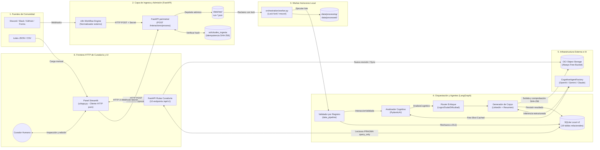
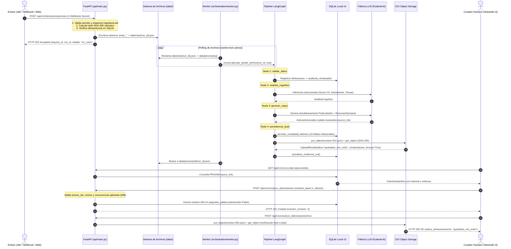

# Arquitectura de CommunityLab
**Documento Maestro de Arquitectura de Software y Contratos Canónicos de Datos**  
*Hackathon ONE G10 (Oracle Next Education & Alura) / No Country · Equipo 34*  
*Versión Consolidada para Demo Day (27 de Octubre de 2026)*

---

## 1. Visión General y Propósito del Sistema

**CommunityLab** es un motor inteligente de transformación, enriquecimiento cognitivo y distribución automatizada diseñado para capturar el flujo continuo de interacciones no estructuradas en comunidades digitales (Discord, Slack, foros, GitHub y formularios) y convertirlas sistemáticamente en activos de difusión pública y conocimiento institucional.

El sistema resuelve la brecha crítica entre el volumen caótico de interacción comunitaria y la necesidad institucional de difundir logros y sintetizar aprendizajes, garantizando rigor factual, auditabilidad matemática y persistencia inmutable en la nube.

```
┌─────────────────┐       ┌─────────────────┐       ┌──────────────────┐       ┌──────────────────┐
│  Comunidades    │       │   Ingesta API   │       │   Pipeline IA    │       │  Curaduría Web   │
│ (Discord/Slack/ │ ────> │  (FastAPI 202)  │ ────> │ (LangGraph +     │ ────> │  (Streamlit UI   │
│  Forms/GitHub)  │       │  Idempotencia   │       │  PydanticAI)     │       │   + OCI Storage) │
└─────────────────┘       └─────────────────┘       └──────────────────┘       └──────────────────┘
```

### Principios Fundamentales No Negociables
1. **Política de Cero Hechos Inventados (*Zero Invented Facts*):** Ningún modelo generativo puede redactar copys de marketing sin asociar obligatoriamente una lista no vacía de identificadores de mensajes fuente (`source_ids >= 1`), vinculados de forma estricta a los registros evaluados en la ingesta.
2. **Validación en Dos Capas y Aislamiento de Fallos (R1 / M03):** La capa perimetral HTTP es permisiva respecto a fechas y cadenas para evitar caídas masivas de lotes con errores HTTP 422; el pipeline de datos local ejecuta una validación estricta registro a registro, aislando mensajes defectuosos o vacíos hacia tablas de auditoría en SQLite (`auditoria_rechazados`), permitiendo que los registros válidos continúen hacia los agentes LLM.
3. **Generación Simultánea de Formatos Base (Regla M01):** El enrutamiento condicional según el enfoque editorial predominante (`Logro`, `Duda`, `Dificultad`) modula el tono, el ángulo comunicacional y la narrativa, pero el pipeline **siempre genera de forma simultánea ambos formatos base**: publicación para LinkedIn (`post_linkedin`) y resumen semanal (`resumen_semanal`), acompañados de los casos no publicables para curaduría (`casos_no_publicables`).
4. **Verificación Activa por Software en OCI (Regla M07 / R7):** El estado `guardado_con_exito` no puede ser alucinado ni asumido; el software ejecuta un `put_object`, realiza de inmediato un `get_object` de comprobación activa y valida la integridad criptográfica del hash SHA-256 byte a byte.
5. **Inmutabilidad de Revisiones Humanas:** Cada acción del gestor de comunidad en el panel web (edición de texto, aprobación o rechazo) crea una nueva versión determinista incremental (`revision-001.json`, `revision-002.json`). Queda prohibida la sobreescritura destructiva de borradores previos.

---

## 2. Arquitectura de Alto Nivel y Flujo Desacoplado

La arquitectura de CommunityLab implementa una estricta segregación de responsabilidades en cuatro capas desacopladas que se comunican mediante contratos tipados y almacenamiento compartido.

### 2.1. Diagrama de Servicios y Componentes



### 2.2. Diagrama de Secuencia: Ciclo de Vida de un Lote



---

## 3. Esquemas de Datos y Contratos Canónicos (Sección Nuclear)

La totalidad de los contratos del sistema está centralizada en `esquemas.py`. Ningún componente modifica estos esquemas; actúan como la interfaz inmutable de comunicación.

```
┌────────────────────────────────────────────────────────────────────────┐
│                              esquemas.py                               │
├──────────────────────────┬─────────────────────────────┬───────────────┤
│ Contrato 1: Ingesta      │ Contrato 2: Análisis        │ Contrato 3:   │
│ - IngestionLote          │ - AnalisisCognitivo         │ Distribución  │
│ - Interaccion            │ - MensajeAnalizado          │ - PaqueteSalida│
│ - InteraccionValidada    │ - PuntuacionRelevancia      │ - Activos     │
│ - MetadataOrigen         │ - ResumenComunidad          │ - Revision    │
│ - MetadataOrigenValidado │                             │ - OCI         │
└──────────────────────────┴─────────────────────────────┴───────────────┘
```

### 3.1. Contrato 1: Ingesta y Admisión (`IngestionLote`)

Diseñado bajo el principio de **validación en dos capas**:
* **Capa 1 (Admisión perimetral en API):** `MetadataOrigen` admite fechas en formato `str` (ISO-8601 permisivo) e `Interaccion` admite `texto: Optional[str]` vacío, garantizando que un mensaje defectuoso no aborte el transporte HTTP del lote completo.
* **Capa 2 (Pipeline de datos local):** `MetadataOrigenValidado` exige un objeto `datetime` de Python, e `InteraccionValidada` impone un validador de campo (`validar_texto_no_vacio`) que rechaza cadenas vacías o espacios en blanco (`min_length=1`).
* **Adaptador de Frontera (`adaptar_payload_oficial`):** Transforma de manera determinista e idempotente el JSON plano del jurado (que carece de `id` y `metadata_origen`) en un sobre `IngestionLote` canónico, derivando fechas de respaldo según el período de referencia.

```python
from datetime import datetime
from typing import List, Optional
from pydantic import BaseModel, Field, field_validator

class MetadataOrigen(BaseModel):
    """Metadatos de origen para la capa de admisión (permisiva, fecha como string)."""
    plataforma: str = Field(..., description="Plataforma de origen: Discord, Slack, Form, etc.")
    identificador_original: str = Field(..., description="ID nativo del mensaje en la plataforma")
    fecha: str = Field(..., description="Timestamp ISO-8601 del mensaje original")

class MetadataOrigenValidado(BaseModel):
    """Metadatos de origen validados para el pipeline interno (fecha parseada a datetime)."""
    plataforma: str = Field(..., description="Plataforma de origen: Discord, Slack, Form, etc.")
    identificador_original: str = Field(..., description="ID nativo del mensaje en la plataforma")
    fecha: datetime = Field(..., description="Timestamp parseado y validado como datetime")

class Interaccion(BaseModel):
    id: str
    autor: str = Field(default="Anónimo", description="Nombre o alias del miembro comunitario")
    canal: str
    tipo: str = Field(default="sin_clasificar")
    texto: Optional[str] = Field(default="", description="Puede venir vacío en pruebas de fallo")
    metadata_origen: MetadataOrigen

class IngestionLote(BaseModel):
    schema_version: str = Field(default="1.1.0")
    request_id: str = Field(..., description="Identificador de la solicitud provisto por el emisor (n8n)")
    origen_comunidad: str
    periodo_referencia: str
    interacciones: List[Interaccion] = Field(..., min_length=1)

# Alias retrocompatible para integraciones
IngestionPayload = IngestionLote

class InteraccionValidada(BaseModel):
    """Segunda capa: aplicada por el proceso local antes de pasar el mensaje a los agentes de IA."""
    id: str
    autor: str
    canal: str
    tipo: str
    texto: str = Field(..., min_length=1, description="Texto no vacío exigido para análisis")
    metadata_origen: MetadataOrigenValidado

    @field_validator("texto")
    @classmethod
    def validar_texto_no_vacio(cls, v: str) -> str:
        if not v or not v.strip():
            raise ValueError("El texto de la interacción no puede estar vacío ni contener solo espacios")
        return v.strip()
```

---

### 3.2. Contrato 2: Análisis Cognitivo (`AnalisisCognitivo`)

Estructura de salida generada por el agente cognitivo de PydanticAI sobre cada mensaje validado:
* **Sentimiento Categórico:** Restringido a 4 clases discretas: `Literal["Altamente Positivo", "Positivo", "Neutro", "Dificultad/Negativo"]`.
* **Categorías de Enrutamiento:** Restringido a 3 categorías editoriales: `Literal["Logro", "Duda", "Dificultad"]`.
* **Puntuación de Relevancia (0 a 6 puntos):** Suma entera de tres dimensiones fundamentales (0 a 2 cada una):
  1. `evidencia_explicita`: Hechos y datos verificables.
  2. `utilidad_comunitaria`: Valor formativo para el colectivo.
  3. `claridad_contexto`: Capacidad de comprensión aislada.
  * *Cálculo Determinista:* Un validador de modelo (`@model_validator(mode="after")`) computa aritméticamente el campo `total = evidencia_explicita + utilidad_comunitaria + claridad_contexto`, garantizando que el LLM no alucine la suma matemática.
* **Justificación Obligatoria:** `motivo_seleccion` exige un mínimo de 10 caracteres (`min_length=10`).
* **Resumen de Comunidad:** Agrega métricas consolidadas, aplicando la regla de polaridad predominante `"Mixto"` en caso de empate entre frecuencias máximas y preservando la invariante `registros_validos + registros_rechazados == total_interacciones_procesadas`.

```python
from typing import Dict, List, Literal
from pydantic import BaseModel, Field, model_validator

Sentimiento = Literal["Altamente Positivo", "Positivo", "Neutro", "Dificultad/Negativo"]
CategoriaEnrutamiento = Literal["Logro", "Duda", "Dificultad"]

class PuntuacionRelevancia(BaseModel):
    evidencia_explicita: int = Field(..., ge=0, le=2)
    utilidad_comunitaria: int = Field(..., ge=0, le=2)
    claridad_contexto: int = Field(..., ge=0, le=2)
    total: int = Field(default=0, ge=0, le=6)

    @model_validator(mode="after")
    def calcular_total(self):
        self.total = self.evidencia_explicita + self.utilidad_comunitaria + self.claridad_contexto
        return self

class MensajeAnalizado(BaseModel):
    source_id: str = Field(..., description="Referencia exacta al id del mensaje")
    sentimiento: Sentimiento
    categoria_enrutamiento: CategoriaEnrutamiento
    regla_aplicada: str = Field(..., description="Criterio documentado para derivar el contenido")
    temas: List[str] = Field(..., min_length=1)
    entidades_relevantes: List[str] = Field(default_factory=list)
    puntuacion_relevancia: PuntuacionRelevancia
    motivo_seleccion: str = Field(..., min_length=10, description="Justificación objetiva de la puntuación")
    requiere_soporte: bool = Field(default=False, description="Marca casos que requieren canalización o mentoría")
    apto_para_publicacion: bool = Field(..., description="Determina si el mensaje califica para difusión pública")

class ResumenComunidad(BaseModel):
    total_interacciones_procesadas: int = Field(..., ge=1)
    registros_validos: int = Field(..., ge=1)
    registros_rechazados: int = Field(default=0, ge=0)
    sentimiento_predominante: str = Field(..., description="Polaridad dominante o 'Mixto'")
    distribucion_sentimiento: Dict[str, int]
    temas_principales: List[str] = Field(..., min_length=1)
    alertas_soporte: List[str] = Field(default_factory=list)

class AnalisisCognitivo(BaseModel):
    run_id: str = Field(..., description="ID de ejecución asignado por la API")
    request_id: str = Field(..., description="ID de la solicitud original")
    resumen_comunidad: ResumenComunidad
    mensajes_analizados: List[MensajeAnalizado] = Field(..., min_length=1)
```

---

### 3.3. Contrato 3: Distribución, Curaduría y Evidencia OCI (`PaqueteSalida`)

El paquete canónico de salida representa el artefacto final inmutable que se persiste en SQLite y OCI Object Storage:
* **Activos Generados:** Contiene simultáneamente `post_linkedin` (`PostLinkedIn`), `resumen_semanal` (`ResumenSemanal`) y la lista de `casos_no_publicables` (`List[CasoNoPublicable]`).
* **Invariantes de Trazabilidad (`source_ids`):**
  - `PostLinkedIn`: Debe fundamentarse exclusivamente en mensajes que tengan `apto_para_publicacion = True` ($S_{\text{post}} \subseteq A$).
  - `ResumenSemanal`: Puede citar cualquier mensaje validado y procesado ($S_{\text{resumen}} \subseteq M$).
  - Ambos exigen listas no vacías (`min_length=1`). Ningún activo se genera en el vacío.
* **Casos No Publicables (`CasoNoPublicable`):** Vista derivada determinista construida mediante `CasoNoPublicable.desde_mensaje_analizado(mensaje)` sobre mensajes con `apto_para_publicacion = False`. Rechaza mensajes aptos y preserva los motivos para auditoría humana.
* **Metadatos de Ejecución:** Trazabilidad de latencia total, tokens e identificadores de modelo/prompt (`"gpt-4o-mini + gpt-4o-mini"`).
* **Estado de Revisión:** Control de versiones con secuencia incremental `numero_revision` (1, 2, 3...), estado (`"pendiente"`, `"aprobado"`, `"rechazado"`), identificador del revisor humano y marca de tiempo UTC.
* **Evidencia de Almacenamiento OCI:** Declaración del bucket, ruta inmutable, `status_almacenamiento` (`"guardado_con_exito"`, `"guardado_error"`, `"no_iniciado"`) y comprobación de lectura activa (`comprobacion_lectura: bool`).

```python
from datetime import datetime, timezone
from typing import List, Literal, Optional
from pydantic import BaseModel, Field

class PostLinkedIn(BaseModel):
    titulo: str = Field(..., min_length=5)
    canal_recomendado: str = Field(default="LinkedIn Oficial")
    cuerpo: str = Field(..., min_length=20)
    hashtags: List[str] = Field(default_factory=list)
    source_ids: List[str] = Field(..., min_length=1, description="IDs de mensajes que respaldan la publicación")

class ResumenSemanal(BaseModel):
    seccion: str
    titular: str = Field(..., min_length=5)
    resumen: str = Field(..., min_length=20)
    source_ids: List[str] = Field(..., min_length=1, description="IDs de mensajes que respaldan la síntesis")

class CasoNoPublicable(BaseModel):
    """Mensaje analizado que NO califica para difusión pública, expuesto al curador."""
    source_id: str = Field(..., description="Referencia exacta al id del mensaje")
    sentimiento: Sentimiento
    categoria_enrutamiento: CategoriaEnrutamiento
    temas: List[str] = Field(..., min_length=1)
    requiere_soporte: bool = Field(default=False)
    motivo_seleccion: str = Field(..., min_length=10)

    @classmethod
    def desde_mensaje_analizado(cls, mensaje: "MensajeAnalizado") -> "CasoNoPublicable":
        if mensaje.apto_para_publicacion:
            raise ValueError(f"El mensaje {mensaje.source_id!r} es apto; no puede ser un caso no publicable")
        return cls(
            source_id=mensaje.source_id,
            sentimiento=mensaje.sentimiento,
            categoria_enrutamiento=mensaje.categoria_enrutamiento,
            temas=list(mensaje.temas),
            requiere_soporte=mensaje.requiere_soporte,
            motivo_seleccion=mensaje.motivo_seleccion,
        )

class ActivosGenerados(BaseModel):
    post_linkedin: PostLinkedIn
    resumen_semanal: ResumenSemanal
    casos_no_publicables: List[CasoNoPublicable] = Field(default_factory=list)

class MetadatosEjecucion(BaseModel):
    modelo: str = Field(..., description="Identificador exacto del LLM")
    prompt_version: str = Field(..., description="Versión del prompt utilizado")
    latencia_ms: int = Field(..., ge=0)
    tokens_totales: int = Field(..., ge=0)

class EstadoRevision(BaseModel):
    numero_revision: int = Field(default=1, ge=1, description="Secuencia incremental de versión")
    estado: Literal["pendiente", "aprobado", "rechazado"] = "pendiente"
    revisor: Optional[str] = Field(default=None, description="Alias o identificador del curador humano")
    fecha_decision: Optional[datetime] = None
    comentarios: Optional[str] = None

class EvidenciaAlmacenamientoOCI(BaseModel):
    bucket: str = Field(default="communitylab-activos-marketing")
    ruta_objeto: str = Field(..., description="Ruta inmutable: activos/{periodo}/{run_id}/revision-{num}.json")
    status_almacenamiento: Literal["guardado_con_exito", "guardado_error", "no_iniciado"] = "no_iniciado"
    comprobacion_lectura: bool = Field(default=False, description="True solo si se verificó SHA-256 en OCI")

def fecha_utc_ahora() -> datetime:
    return datetime.now(timezone.utc)

class PaqueteSalida(BaseModel):
    schema_version: str = "1.1.0"
    run_id: str
    request_id: str
    fecha_generacion: datetime = Field(default_factory=fecha_utc_ahora)
    metadatos_ejecucion: MetadatosEjecucion
    analisis_resumido: ResumenComunidad
    activos: ActivosGenerados
    revision: EstadoRevision = Field(default_factory=EstadoRevision)
    almacenamiento_oci: EvidenciaAlmacenamientoOCI
```

---

### 3.4. Modelos de Curaduría y Frontera HTTP (`storage/modelos_curaduria.py`)

Para evitar que el panel web de Streamlit interprete listas vacías de forma ambigua, las consultas exponen un encabezado de disponibilidad semántica:

* **Sobre de Disponibilidad Explícita (`SobreEstadoRun`):**
  - `estado`: Estado operativo (`"recibiendo"`, `"en_cola"`, `"procesando"`, `"completado"`, `"sin_registros_validos"`, `"sin_contenido_publicable"`, `"fallido"`).
  - `categoria_estado`: Agrupador semántico para la interfaz:
    - `"en_curso"`: Lote aún en procesamiento. La UI muestra indicador de espera y bloquea botones.
    - `"finalizada_con_paquete"`: Pipeline completado con activos listos para curaduría.
    - `"finalizada_sin_paquete"`: Lote terminal sin activos publicables (sin registros o sin mensajes aptos).
    - `"fallida"`: Falla irrecuperable en worker o LLM.
  - `disponible: bool`: Indica si hay datos para la vista consultada.
  - `motivo: Optional[Literal["en_curso", "sin_paquete", "sin_analisis"]]`: Razón explícita cuando `disponible = False`.

#### Matriz de las 10 Operaciones HTTP de Curaduría
Todas las rutas operan bajo el prefijo `/api/v1` en [api/rutas_curaduria.py]:

| # | Operación HTTP | Método y Ruta | Modelo de Respuesta | Códigos de Estado y Errores |
|---|---|---|---|---|
| 1 | `listar_ejecuciones` | `GET /runs` | `RespuestaListarEjecuciones` | 200 OK, 401, 422 `parametro_invalido` |
| 2 | `obtener_ejecucion` | `GET /runs/{run_id}/detalle` | `RespuestaDetalleEjecucion` | 200 OK, 401, 404 `ejecucion_no_encontrada` |
| 3 | `listar_mensajes` | `GET /runs/{run_id}/mensajes` | `RespuestaListarMensajes` | 200 OK, 401, 404, 422 |
| 4 | `obtener_fuentes` | `GET /runs/{run_id}/fuentes?source_ids=a,b` | `RespuestaObtenerFuentes` | 200 OK, 401, 404, 422 |
| 5 | `obtener_resumen` | `GET /runs/{run_id}/resumen` | `RespuestaObtenerResumen` | 200 OK, 401, 404 |
| 6 | `listar_rechazados` | `GET /runs/{run_id}/rechazados` | `RespuestaListarRechazados` | 200 OK, 401, 404, 422 |
| 7 | `listar_revisiones` | `GET /runs/{run_id}/revisiones` | `RespuestaListarRevisiones` | 200 OK, 401, 404 |
| 8 | `obtener_revision` | `GET /runs/{run_id}/revisiones/{n}` | `RespuestaObtenerRevision` | 200 OK, 401, 404 `revision_no_encontrada` |
| 9 | `registrar_revision` | `POST /runs/{run_id}/revisiones` | `RespuestaRegistrarRevision` | 201 Created, 401, 404, 409 `conflicto_revision`, 422 `revision_invalida` |
| 10 | `guardar_revision_en_oci` | `POST /runs/{run_id}/revisiones/{n}/oci` | `RespuestaGuardarOCI` | 200 OK, 401, 404 |

* **Formato Canónico de Error:** Toda respuesta de error en la API preserva la estructura `{"error": "<codigo>", "detalle": "<mensaje>"}`. En el caso de conflicto de concurrencia optimista (`HTTP 409 conflicto_revision`), se incluye el campo entero `revision_actual` para permitir a la UI recargar la última versión sin destruir el texto editado por el curador.

---

## 4. Estrategia de Persistencia Dual

CommunityLab desacopla la persistencia en dos motores complementarios: SQLite local para analítica relacional de alto rendimiento y OCI Object Storage Always Free para inmutabilidad y auditoría cloud.

```
┌────────────────────────────────────────────────────────┐
│                   Persistencia Dual                    │
├───────────────────────────┬────────────────────────────┤
│ SQLite Local v2           │ OCI Object Storage         │
│ - 19 Tablas relacionales  │ - Always Free Bucket       │
│ - 6 Vistas analíticas     │ - Convención inmutable:    │
│ - Modo WAL                │   activos/{periodo}/       │
│ - PRAGMA query_only       │   {run_id}/revision-*.json │
│ - PK compuesta            │ - Verificación SHA-256     │
│   (run_id, source_id)     │   byte a byte              │
└───────────────────────────┴────────────────────────────┘
```

### 4.1. Persistencia Local Relacional (SQLite v2)

Implementada en [storage/local_db.py] sobre `data/communitylab.db`:
* **Modo WAL (`PRAGMA journal_mode = WAL`):** Permite lecturas concurrentes sin bloqueo mientras el pipeline o worker escribe.
* **Aislamiento en Lecturas:** Toda consulta de curaduría se ejecuta bajo `PRAGMA query_only = ON`. Un fallo en SQLite nunca devuelve una lista vacía; lanza `LecturaFallida` (HTTP 503).
* **Claves Primarias Compuestas:** La tabla nuclear `mensajes_analizados` y sus tablas hijas (`mensaje_temas`, `mensaje_entidades`, `post_linkedin_source_ids`, `resumen_semanal_source_ids`) utilizan `PRIMARY KEY (run_id, source_id)`, eliminando colisiones cuando múltiples lotes comparten IDs similares.
* **Atomicidad en `persistir_resultado()`:** Registra en una sola transacción `BEGIN IMMEDIATE` el lote padre (`lotes_procesamiento`), la auditoría de descartes (`auditoria_rechazados`), el análisis cognitivo, el paquete de salida y la telemetría.
* **Segregación de Descartes:** La tabla `auditoria_rechazados` clasifica los registros aislados mediante la columna `origen`: `'validador'` para fallos de esquema o texto vacío, y `'analisis'` para descartes cognitivos.

#### Esquema de Tablas (19 Tablas Relacionales)
1. `lotes_procesamiento`: Maestro de ejecuciones, estados (`estado_flujo`) y totales.
2. `mensajes_analizados`: Tabla nuclear de scoring (0-6), sentimiento y justificación.
3. `mensaje_temas`: Tópicos extraídos por mensaje.
4. `mensaje_entidades`: Entidades tecnológicas y conceptos clave.
5. `resumen_comunidad`: Síntesis global del lote y sentimiento predominante.
6. `resumen_distribucion_sentimiento`: Conteo por clase de polaridad.
7. `resumen_temas_principales`: Temas agregados ordenados por relevancia.
8. `resumen_alertas_soporte`: Alertas de miembros con bloqueos o dificultades.
9. `paquetes_salida`: Maestro de versiones de salida por `(run_id, numero_revision)`.
10. `metadatos_ejecucion_paquete`: Modelo, prompt_version, latencia y tokens.
11. `post_linkedin`: Título, canal recomendado y cuerpo del copy de LinkedIn.
12. `post_linkedin_hashtags`: Etiquetas generadas.
13. `post_linkedin_source_ids`: Identificadores fuente verificados del post.
14. `resumen_semanal`: Sección, titular y síntesis semanal.
15. `resumen_semanal_source_ids`: Identificadores fuente verificados del resumen.
16. `estado_revision`: Historial inmutable de revisiones, revisor y comentarios.
17. `evidencia_almacenamiento_oci`: Registro del bucket, ruta y verificación de lectura.
18. `telemetria_llamadas_llm`: Auditoría de consumo de tokens y latencias.
19. `auditoria_rechazados`: DLQ relacional de mensajes descartados con texto crudo y motivo.

*(Nota: La capa perimetral API gestiona además la tabla `solicitudes_ingesta` para garantizar la idempotencia por hash SHA-256).*

#### Vistas Analíticas (6 Vistas SQL)
* `vista_resumen_sentimiento`: Agregación de polaridad y score promedio por ejecución y período.
* `vista_temas_tendencia`: Frecuencia de aparición de tópicos y relevancia media comunitaria.
* `vista_alertas_soporte`: Filtrado rápido de casos con `requiere_soporte = 1` o sentimiento negativo.
* `vista_candidatos_publicacion`: Mensajes de logro destacados con puntuación total $\ge 4$.
* `vista_telemetria_lote`: Latencias medias y consumo de tokens totales/cacheados por proveedor.
* `vista_cola_curaduria`: Borradores en estado `'pendiente'` listos para revisión humana.

---

### 4.2. Persistencia Cloud Inmutable (OCI Object Storage Always Free)

Implementada en [storage/oci_client.py]:
* **Jerarquía Determinista Libre de Colisiones:**
  ```text
  activos/{periodo_referencia}/{run_id}/revision-{numero_revision:03d}.json
  ```
  *(Ejemplo: `activos/Semana_04/run-20261024T183000Z-a1b2c3d4e5f6/revision-001.json`)*.
* **Verificación Activa por Software (Regla M07):**
  1. Serializa el `PaqueteSalida` forzando previamente `status_almacenamiento = "no_iniciado"` y `comprobacion_lectura = False` para que la representación en bytes sea determinista.
  2. Calcula el hash `SHA-256` en memoria antes de la subida.
  3. Ejecuta `put_object` en el bucket de OCI (`communitylab-activos-marketing`).
  4. Realiza inmediatamente un `get_object` leyendo el cuerpo remoto byte a byte.
  5. Computa el hash `SHA-256` del contenido recuperado y verifica coincidencia binaria estricta.
  6. Únicamente si los hashes son idénticos, fija `status_almacenamiento = "guardado_con_exito"` y `comprobacion_lectura = True`.
* **Idempotencia Activa:** Si el objeto ya existe en OCI y su contenido coincide exactamente byte a byte, el cliente reconoce la operación como exitosa sin duplicar transferencias ni arrojar error (`reintento_idempotente = True`).
* **Resiliencia ante Fallos de Red:** Si las credenciales OCI no están presentes o la red falla, la operación registra `status_almacenamiento = "guardado_error"` con el detalle en `mensaje_error`. El paquete permanece resguardado en SQLite y el proceso `sincronizar_pendientes_oci()` permite su reintento posterior.

---

## 5. Módulo de IA, Fábrica Multi-Proveedor y Resiliencia

### 5.1. Fábrica Desacoplada (`CognitiveAgentFactory`)
Ubicada en [ai_modules/multiprovider_agent.py], desacopla la lógica de negocio de los proveedores de LLM:
* **Conmutación en Caliente (*Hot-Swapping*):** Mediante la variable de entorno `LLM_PROVIDER`, el sistema conmuta sin tocar código entre:
  - **OpenAI:** `gpt-4o-mini` (titular de producción).
  - **Google Gemini:** `gemini-3.5-flash` (calibración y velocidad).
  - **Anthropic Claude:** `claude-haiku-4-5-20251001` (contingencia analítica).
  - **Groq / OpenRouter:** Compatible mediante endpoints estándar OpenAI.

### 5.2. Optimización y Prompt Caching Nativo
El catálogo estático de evaluación (*few-shot catalog*) contiene las instrucciones del sistema y ejemplos de scoring (0 a 6). La arquitectura aplica la estrategia de caché nativa de cada proveedor:
* **OpenAI:** Caching implícito por coincidencia de prefijo idéntico byte a byte.
* **Anthropic:** Caching declarativo mediante `AnthropicModelSettings(anthropic_cache_instructions=True)` con TTL de 5 minutos (`cache_control`).
* **Gemini:** Caching implícito de prefijo en modo sin estado (*stateless*).
* *Impacto en Pruebas:* Se observaron reducciones de más de 18.000 tokens cacheados por ejecución de lote, disminuyendo la latencia de análisis en más de un 60%.

### 5.3. Políticas de Privacidad y Degradación Elegante
* **Sanitización Preventiva de PII (`_enmascarar_pii`):** Expresiones regulares reemplazan direcciones de correo electrónico, números telefónicos y credenciales antes de enviar los datos al LLM o almacenarlos en activos de marketing.
* **Protección en el Resumen Semanal:** Los mensajes no aptos para difusión (`apto_para_publicacion = False`) son incluidos en el análisis global de temas y polaridad, pero su texto textual es omitido del contexto del resumen semanal, resguardando la privacidad de consultas o reclamos.
* **Degradación Elegante (`_activos_degradados`):** Si un proveedor de IA experimenta fallos de red persistentes o límites de cuota (`HTTP 429`), el generador activa plantillas deterministas basadas únicamente en los temas, entidades y textos sanitizados disponibles, garantizando que el lote concluya con activos válidos y trazables sin abortar el flujo.

---

## 6. Panel de Curaduría Humana (Streamlit UI)

Ubicado en [ui/app.py] con transporte en [ui/api_client.py]:
* **Desacoplamiento Absoluto:** El panel web es un cliente HTTP puro; no realiza importaciones de `sqlite3`, no abre conexiones locales a bases de datos ni accede a archivos en disco. Consume exclusivamente los 10 endpoints de la API perimetral.
* **Seguridad:** El token `COMMUNITYLAB_WEBHOOK_SECRET` se administra en el servidor de Streamlit mediante `pydantic-settings` (`SecretStr`) y viaja en la cabecera `X-Webhook-Secret`, sin ser expuesto al navegador.

### Flujo de Navegación en 4 Pasos
```
┌──────────────┐      ┌──────────────┐      ┌─────────────────────────┐      ┌──────────────────┐
│   1. Carga   │ ───> │2. Resultados │ ───> │ 3. Edición y Aprobación │ ───> │4. Almacenamiento │
│ (JSON / CSV) │      │  (Métricas)  │      │   (Post + Resumen)      │      │      (OCI)       │
└──────────────┘      └──────────────┘      └─────────────────────────┘      └──────────────────┘
```

1. **Paso 1: Carga:** Permite arrastrar lotes JSON/CSV o seleccionar ejecuciones previas del histórico (`GET /runs`). Al enviar un archivo, realiza `POST /interactions/process` y recibe `HTTP 202 Accepted`, activando un sondeo visual no bloqueante sobre el estado del lote.
2. **Paso 2: Resultados:** Muestra las métricas agregadas del lote (`GET /resumen`), la tabla de mensajes clasificados (`GET /mensajes`) con filtros interactivos por sentimiento o aptitud, y un visor lateral de citas textuales originales (`GET /fuentes`).
3. **Paso 3: Edición y Aprobación:** Carga la revisión vigente (`GET /revisiones/{n}`). El curador puede editar el titular, cuerpo y hashtags de LinkedIn, ajustar el resumen semanal o rechazar el borrador.
   * *Control de Concurrencia Optimista:* El formulario envía `revision_base`. Si otra pestaña o usuario guardó una revisión superior, el backend responde `HTTP 409 conflicto_revision` indicando `revision_actual`. Streamlit alerta al usuario y evita sobreescribir el trabajo ajeno.
4. **Paso 4: Almacenamiento:** Muestra la evidencia de persistencia en OCI (`GET /revisiones/{n}`). Si la revisión está en `no_iniciado` o `guardado_error`, ofrece el botón «Sincronizar con OCI» (`POST /revisiones/{n}/oci`), actualizando en tiempo real los badges de verificación SHA-256 y permitiendo la descarga del paquete en JSON, Markdown o texto plano.

---

## 7. Configuración, Despliegue y Variables de Entorno

La configuración está centralizada en `backend/config.py` y `api/config.py` a través de `pydantic-settings`:

### Matriz de Variables de Entorno (`.env.example`)
| Variable | Propósito | Requerido | Valor por Defecto |
|---|---|---|---|
| `COMMUNITYLAB_WEBHOOK_SECRET` | Token compartido para autenticar llamadas en la API perimetral y panel web | **Sí** | *(Sin defecto - Fail-Fast)* |
| `LLM_PROVIDER` | Proveedor activo de IA (`openai`, `gemini`, `anthropic`) | No | `openai` |
| `OPENAI_API_KEY` | Clave de API para OpenAI (`gpt-4o-mini`) | Condicional | - |
| `GEMINI_API_KEY` | Clave de API para Google Gemini (`gemini-3.5-flash`) | Condicional | - |
| `ANTHROPIC_API_KEY` | Clave de API para Anthropic Claude | Condicional | - |
| `COMMUNITYLAB_DATA_DIR` | Directorio raíz de datos compartidos (`raw`, `processing`, db) | No | `data/` |
| `OCI_CONFIG_FILE` | Ruta al archivo de configuración del SDK de OCI | Condicional | `~/.oci/config` |
| `OCI_KEY_FILE` | Ruta a la clave privada RSA `.pem` de OCI | Condicional | - |
| `OCI_NAMESPACE` | Namespace de tenancy en Oracle Cloud Infrastructure | Condicional | - |
| `OCI_BUCKET_NAME` | Nombre del bucket Always Free | No | `communitylab-activos-marketing` |
| `OCI_REGION` | Región del tenancy OCI | No | `mx-queretaro-1` |
| `LOG_LEVEL` | Nivel de logging estructurado (`DEBUG`, `INFO`, `WARNING`, `ERROR`) | No | `INFO` |

### Modelo de Despliegue (OCI Always Free)
* **Instancia de Cómputo:** Máquina Virtual Ampere A1 (4 OCPUs, 24 GB RAM) o AMD E2.1 Micro con Ubuntu 24.04 LTS en OCI Always Free.
* **Servicios Co-localizados:**
  - **FastAPI Backend (Puerto 8000):** Administrado con Uvicorn bajo systemd o Docker.
  - **Worker de Orquestación:** Proceso en segundo plano vigilando `data/raw/` bajo exclusión mutua `worker.lock`.
  - **Streamlit Web UI (Puerto 8501):** Servidor web de cara al curador.
  - **n8n Workflow Engine (Puerto 5678):** Contenedor Docker para ingesta continua de webhooks.
* **Almacenamiento Persistente:** Volumen en bloque para SQLite local y bucket Object Storage Always Free para los activos finales.

---

## 8. Cronología y Estado de Consolidación

El ciclo de desarrollo concluye con la consolidación técnica orientada al **Demo Day del 27 de Octubre de 2026**:

| Hito / Fase | Período | Estado | Entregable Consolidado |
|---|---|---|---|
| **Fase 0: Congelamiento de Interfaz** | 24 Octubre | ✅ Completado | Catálogo de Modelos de Respuesta y especificación de 10 operaciones HTTP. |
| **Fase 1: Preparación del Código** | 24 Octubre | ✅ Completado | Desacoplamiento de `orchestration/invariantes.py`, parámetro `sobrescribir=False` y `actualizar_evidencia_oci`. |
| **Fase 2: Consultas de Lectura** | 24–25 Octubre | ✅ Completado | Implementación de operaciones 1 a 8 en `storage/consultas.py` con `SobreEstadoRun` y `PRAGMA query_only`. |
| **Fase 3: Revisiones y OCI** | 25 Octubre | ✅ Completado | Implementación de operaciones 9 y 10 en `storage/revisiones.py` con control optimista (409) y verificación SHA-256. |
| **Fase 4: Exposición HTTP en FastAPI** | 25 Octubre | ✅ Completado | Montaje de `api/rutas_curaduria.py`, autenticación uniforme y formateador canónico de errores `{"error", "detalle"}`. |
| **Fase 5: Integración y Curaduría** | 26 Octubre | ✅ Completado | Panel de Streamlit (`ui/`) conectado como cliente HTTP puro con recorrido end-to-end verificado. |
| **Fase 6: Congelamiento y Demo Day** | 27 Octubre | 🚀 Listo | Presentación final ante el jurado con suite completa en verde y cero fallos. |

### Métricas de Validación y Calidad de Código
* **Suite Automatizada de Pruebas:** **361 passed, 1 skipped, 0 failed** ejecutadas limpiamente en `143.37s`.
* **Cumplimiento de Linter:** `uv run ruff check` con 0 errores y 0 advertencias en todo el árbol de código fuente.
* **Lockfile Determinista:** Manifiesto `pyproject.toml` y `uv.lock` congelados rigurosamente bajo Python 3.11.