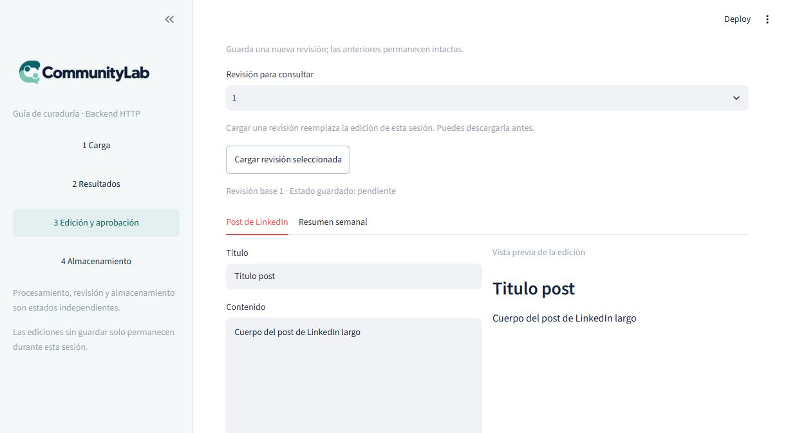
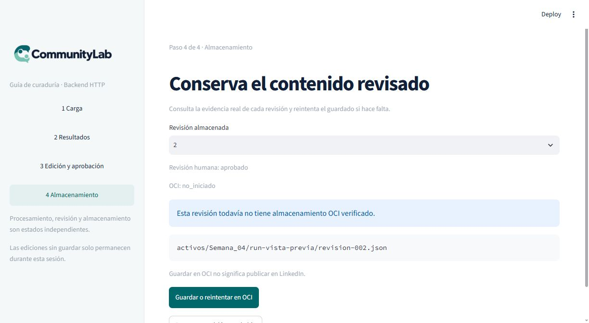

# Evidencia · integración HTTP del panel

Fecha: 25 de octubre de 2026. Base backend: `3adc54c`, rama
`feat/consultas-curaduria-revisiones`. Aporte: `feat/ui-integracion-http`.

## Resultado

El panel usa las diez rutas de curaduría y las rutas de admisión/seguimiento.
Se conserva el diseño y se reemplaza el flujo simulado por operaciones HTTP.
El backend administra la base y la numeración de revisiones; la UI preserva las
fuentes y no asigna evidencia OCI.

## Verificación realizada

- `uv run --frozen pytest -q`: **374 passed, 1 skipped, 2 deselected**.
  La omisión corresponde a una prueba del worker que no aplica cuando existe
  el runner. Las pruebas marcadas de integración real quedaron excluidas.
- Tras el último ajuste de manejo de respuesta: pruebas focalizadas del panel,
  cliente y respaldo histórico: **16 passed**.
- `ruff check` de los cinco archivos Python modificados/nuevos: sin hallazgos.
- AppTest contra FastAPI y SQLite temporal: lectura, aprobación, conflicto por
  revisión concurrente, conservación del texto al navegar, estados sin paquete
  y respuesta HTTP 200 con `guardado_error` sin mostrar éxito.
- Cliente HTTP: autenticación, códigos 401/404/409/413/422/503, JSON inválido,
  timeout de escritura sin reintento automático y validación de modelos de respuesta.
- Navegador: ejecución sintética recuperada por API, editor y aprobación de
  revisión 1 a 2; consulta posterior mostró `aprobado` y OCI `no_iniciado`.

## Capturas reales de la vista previa

Las imágenes contienen datos sintéticos sembrados en SQLite temporal. No son
prueba de generación LLM ni subida a OCI. Se abrió Streamlit contra una API
local; la aprobación sí persistió en la base temporal.

## Pendiente para aceptación E2E

Ejecutar API, worker, proveedores de IA y OCI con la configuración del equipo;
subir un lote y verificar la nueva revisión recuperada de OCI. Esta entrega no
acredita ese recorrido externo ni publica contenido en LinkedIn.

La rama depende del backend de curaduría. Revisar el diff contra esa rama para
no atribuir al frontend los cambios del equipo de backend.
