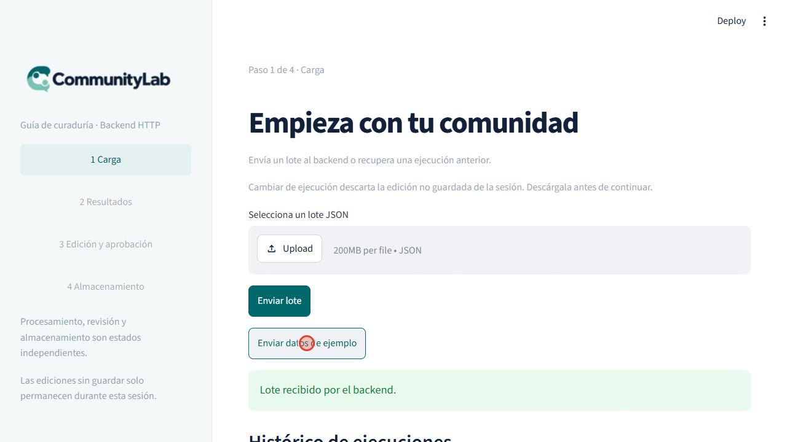
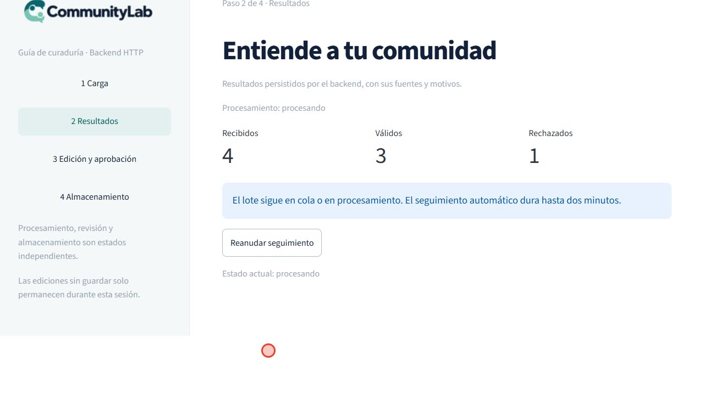
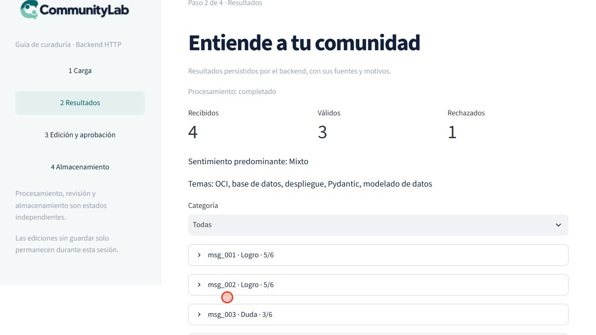
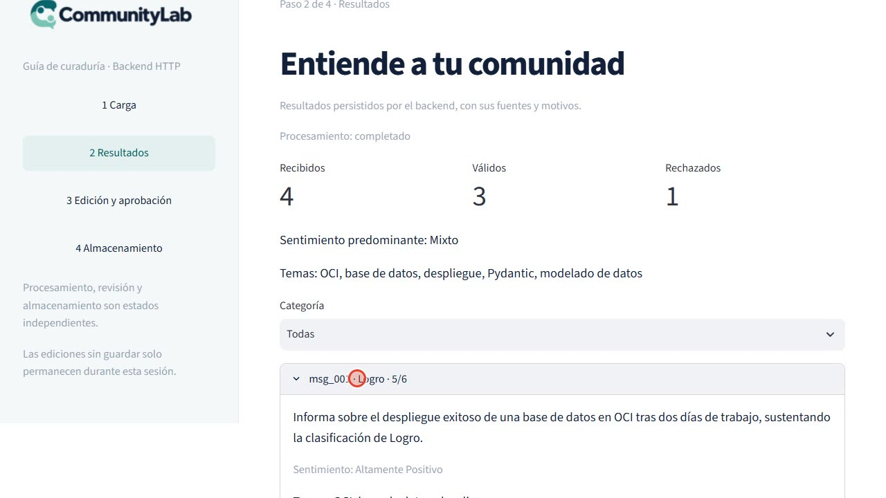
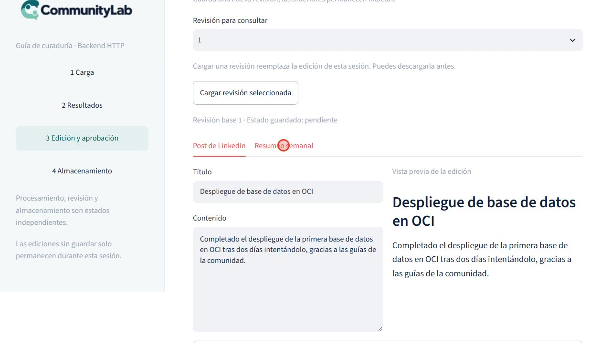
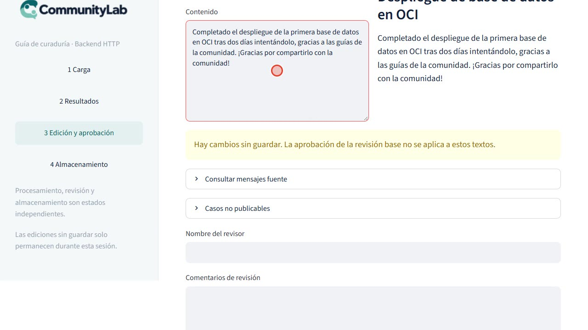
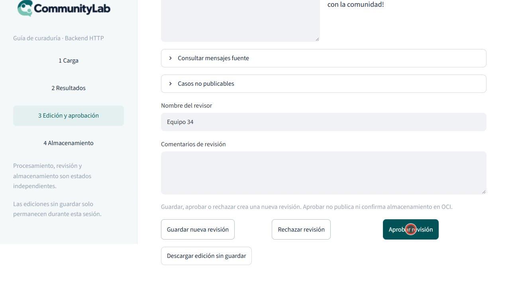
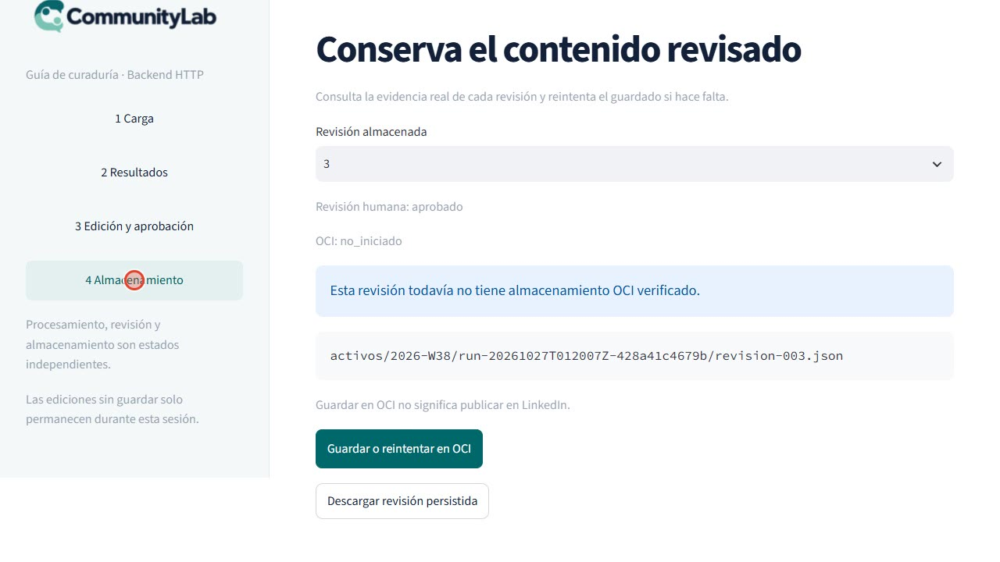
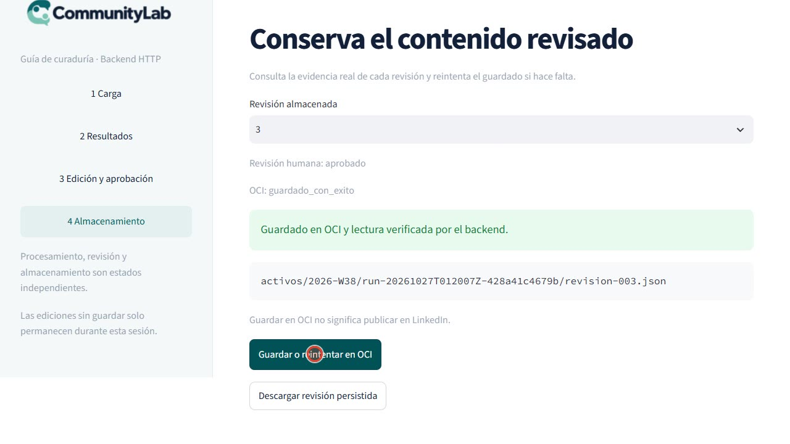
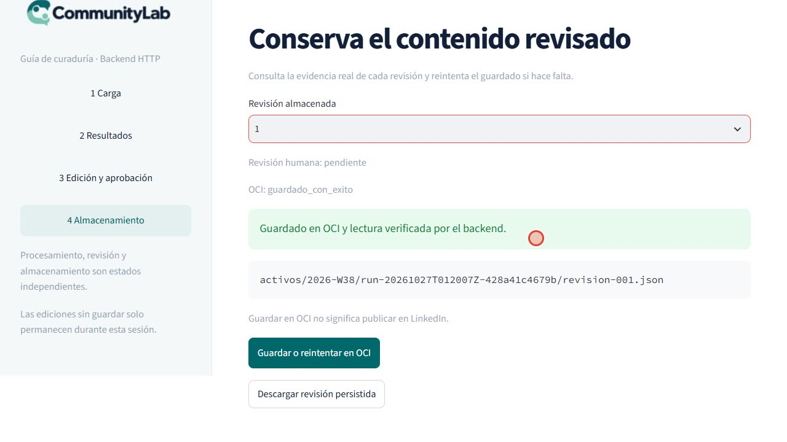

# Prueba de punta a punta con Gemini (tier 1): modelo, rendimiento y comparativa

Fecha: 26 de octubre de 2026. Ejecutada por Sergio (Frontend) con datos sintéticos.
Cierra el ciclo de pruebas con IA real del día: complementa
[`2026-10-26-e2e-groq-generacion-real.md`](2026-10-26-e2e-groq-generacion-real.md),
[`2026-10-26-e2e-openrouter-generacion-real.md`](2026-10-26-e2e-openrouter-generacion-real.md)
y las pruebas negativas
[PN-001/PN-002](pruebas-negativas-pn001-pn002.md) y [PN-003/PN-004](pruebas-negativas-pn003-pn004.md).

## 1. Resumen

| Pregunta | Respuesta |
|---|---|
| ¿Funciona el flujo completo panel → API → worker → Gemini → OCI? | ✅ Sí. El run terminó `completado` en **26,2 s** con la configuración por defecto |
| ¿El análisis y la generación son del modelo y no de la plantilla? | ✅ Sí. 0 mensajes degradados y `degradado: false` en la generación |
| ¿Funciona el ciclo de revisión humana (editar, guardar, aprobar)? | ✅ Sí: 3 revisiones encadenadas |
| ¿Funciona el guardado en el bucket del equipo? | ✅ Sí, y se verificó el contenido de forma independiente |
| ¿Funciona el modelo por defecto del código (`gemini-2.5-flash`)? | ❌ **No.** Responde `404`: «ya no está disponible para usuarios nuevos» |
| ¿Qué modelo funcionó? | `gemini-3.6-flash` (3 de 3 llamadas). `gemini-3.5-flash` y `gemini-3.8-flash` sufrieron `503` y *timeouts* |
| ¿Es tan rápido como OpenRouter (6 a 7 s)? | No: con Gemini el run tarda unas **4 veces más** (26,2 s) |
| ¿Quedó algo en el bucket del equipo? | No: se borraron los 2 objetos de la prueba y los 6 de otros compañeros siguen intactos |

**Conclusión.** Con una cuenta de pago de Gemini el sistema funciona de punta a punta sin
ajustes de concurrencia ni tiempos. Las dos cosas que hay que corregir son de
configuración, no de lógica: el **modelo por defecto está obsoleto** y los modelos nuevos de
Gemini tienen **picos de demanda** que conviene cubrir con reintentos.

## 2. Contexto: qué cambió desde la prueba del 25 de octubre

El 25 de octubre la generación con IA no se pudo validar: la clave gratuita de Gemini
devolvía `429` (cuota) y el contenido caía a la plantilla de respaldo. Desde entonces:

- Sergio configuró una clave de **Gemini tier 1** (de pago). Es un dato que indicó Sergio:
  no se consultó el nivel de la cuenta en Google.
- Se fusionaron los PR #28 a #32 y #34 en `main`. El **#34 refuerza las restricciones del
  prompt de LinkedIn**: la versión de prompt de generación cambió de `…973a5f51471e` (pruebas
  de Groq y OpenRouter) a `…435d8519df29` (esta prueba). Hay que tenerlo presente al
  comparar los textos (sección 8).

## 3. Configuración usada

Solo variables de entorno; no se cambió código. El `.env` está fuera de git y **no se
incluye ninguna clave** en este documento.

| Variable | Valor |
|---|---|
| `LLM_PROVIDER` | `gemini` |
| `GEMINI_API_KEY` | *(clave de Gemini tier 1, no se muestra)* |
| `GEMINI_MODEL` | `gemini-3.6-flash` (ver sección 4) |
| `COGNITIVE_ANALYZER_CONCURRENCY`, `LLM_INFERENCE_TIMEOUT_SEC`, `LLM_MAX_RETRIES` | **Sin definir**: valores por defecto del proyecto (concurrencia 5, espera de 30 s, 3 reintentos) |

Credenciales OCI: las de la aplicación del equipo, región `mx-queretaro-1` y bucket del
equipo, con la clave en `secrets/` (excluida por `.gitignore`).

**Una trampa del `.env`.** El archivo tenía dos líneas `GEMINI_MODEL`: una con el texto
literal de la plantilla (`<modelo>`) y otra con el alias `gemini-flash-latest`. Con claves
repetidas, el valor que se aplica depende del cargador, así que la prueba habría usado un
modelo distinto del esperado. Se dejó una sola línea con el modelo explícito.

## 4. Elección del modelo

La clave tiene acceso a una lista amplia de modelos con `generateContent`, pero **aparecer en
el listado no garantiza que respondan**. Se probó cada candidato con la fábrica real de
agentes del proyecto y salida estructurada (3 llamadas por modelo):

| Modelo | Resultado | Detalle |
|---|---|---|
| `gemini-2.5-flash` (**por defecto del código**) | ❌ `404` ×3 | «This model is no longer available to new users» (Google sugiere `gemini-3.8-flash`) |
| `gemini-3.8-flash` | ❌ *timeout*, `503`, *timeout* | «Experiencing high demand» |
| `gemini-3.5-flash` | ⚠️ `503`, `503`, OK | La llamada que respondió tardó 4,6 s |
| `gemini-3.6-flash` | ✅ OK ×3 | 5,3 s, 2,6 s y 4,8 s |

Se fijó `gemini-3.6-flash`. No se probaron `gemini-3.7-flash` ni las variantes *lite*.

**Hallazgo.** El modelo por defecto del código (`gemini-2.5-flash`) y el que figura en
`.env.example` están obsoletos para cuentas nuevas. Un compañero que clone el repositorio y
use solo su clave obtendrá un `404` y un análisis totalmente degradado. No se modificó ningún
valor por defecto: es una decisión del equipo.

## 5. Piezas y aislamiento

| Pieza | Detalle |
|---|---|
| Código | `main` con los PR #28 a #32 y #34 |
| API, worker y panel | `uvicorn api.main:app` (8053), `python -m orchestration.worker` y Streamlit (8505), con los valores por defecto |
| Datos | `data/raw/lote_prueba_01.json`: 4 mensajes (3 válidos y 1 vacío), enviado **desde el botón del panel** |
| Directorio de datos | Temporal y limpio; no se tocó `data/` del repositorio |
| OCI | Bucket del equipo: al empezar había 6 objetos de compañeros, los mismos que al final |
| Grabación | Fotogramas capturados del navegador (Edge) con cursor visible; sirvió de base para los dos videos |

## 6. Resultados de la corrida

Run `run-20261027T012007Z-428a41c4679b`: **`completado`**, de la recepción al estado final en
**26,2 s**.

| Etapa | Resultado |
|---|---|
| Validación | 3 válidos, 1 rechazado (`msg_004`, vacío) |
| Análisis (3 mensajes) | **13,0 s** en total, con los mensajes en paralelo (promedio de 4,3 s por registro) · 0 degradados · 20.186 tokens de entrada y 4.768 de salida |
| Generación (post + resumen) | **10,4 s** · 880 tokens de entrada y 2.152 de salida · `degradado: false` |
| Guardado en OCI (revisión 1, automático) | Subida 942 ms · lectura de verificación 174 ms · `hash_match: true` |
| Metadatos del paquete | `gemini-3.6-flash + gemini-3.6-flash` · 23,3 s · 27.986 tokens |
| Tokens cacheados | 0 (el caché de prefijo no se activó con Gemini) |

Los 26,2 s se reparten así: unos 23,3 s de IA (análisis más generación), 1,1 s de OCI y el
resto de validación y persistencia. El worker no emitió ningún evento `inferencia_degradada`
ni `generacion_ia_degradada_a_plantilla`.

### Mensajes analizados

| Mensaje | Categoría | Puntuación | Apto | Sentimiento | Temas |
|---|---|---|---|---|---|
| `msg_001` | Logro | 5/6 | Sí | Altamente positivo | OCI, base de datos, despliegue |
| `msg_002` | Logro | 5/6 | Sí | Positivo | Pydantic, modelado de datos |
| `msg_003` | Duda | 3/6 | No | Neutro | n8n, webhooks, configuración |

Resumen del lote: sentimiento predominante «Mixto». Sin alertas de soporte.

### Textos generados (revisión 1, escritos por el modelo)

- **Post de LinkedIn.** «Despliegue de base de datos en OCI. Completado el despliegue de la
  primera base de datos en OCI tras dos días intentándolo, gracias a las guías de la
  comunidad.» Hashtags: OCI, BaseDeDatos, Despliegue.
- **Resumen semanal.** «Grandes hitos en despliegue de bases de datos y modelado con
  Pydantic. Durante esta semana se alcanzaron importantes logros en la comunidad, destacando
  el despliegue exitoso de una base de datos en OCI gracias al apoyo comunitario, así como la
  finalización del modelado de datos mediante esquemas Pydantic y la posterior
  sincronización del repositorio local por parte del equipo.»

Mensaje original de `msg_001`: «¡Logré desplegar mi primera base de datos en OCI tras dos
días intentándolo! Gracias a las guías de la comunidad.» **El post es una paráfrasis fiel, sin
datos añadidos.**

## 7. Recorrido por el panel

### Paso 1 · Carga

Se pulsó **Enviar datos de ejemplo**: «Lote recibido por el backend».



Mientras el worker trabaja, el panel muestra «El lote sigue en cola o en procesamiento» y
consulta el estado solo, cada 3 s. Este paso duró unos 20 s con Gemini.



### Paso 2 · Resultados




### Paso 3 · Edición y aprobación

Revisión 1 generada por el modelo, en estado `pendiente`.



Se añadió una frase al post («¡Gracias por compartirlo con la comunidad!»). El panel avisa de
que hay cambios sin guardar y de que la aprobación de la revisión base no se aplica a esos
textos.



Con el revisor «Equipo 34» se guardó la revisión 2 y se pulsó **Aprobar revisión**.



| Revisión | Estado | Origen | OCI |
|---|---|---|---|
| 1 | `pendiente` | Generada por Gemini | Guardada por el worker, automáticamente |
| 2 | `pendiente` | Edición del revisor («Equipo 34») | `no_iniciado` |
| 3 | `aprobado` | Aprobada por «Equipo 34» | Guardada desde el panel |

### Paso 4 · Almacenamiento




La revisión 1 aparece también como guardada y verificada, porque el worker la subió solo al
terminar el procesamiento.



## 8. Comparativa de todas las pruebas con IA real

| | Gemini gratuito (25 oct) | Groq gratuito (26 oct) | OpenRouter (26 oct) | **Gemini tier 1 (26 oct)** |
|---|---|---|---|---|
| Modelo | `gemini-3.5-flash` / alias `latest` | `openai/gpt-oss-120b` | `openai/gpt-4o-mini` | `gemini-3.6-flash` |
| Cuenta | Clave gratuita | Capa gratuita (8.000 tokens/min) | Saldo de pago | Tier 1 (según Sergio) |
| Configuración del proyecto | Por defecto + modelo fijado | Por defecto: falló; ajustada (concurrencia 1, 150 s, 5 reintentos) | Por defecto | **Por defecto** |
| Resultado | `completado` con plantilla | Por defecto: `sin_contenido_publicable`; ajustada: `completado` | `completado` (2 runs) | `completado` |
| Análisis hecho por el modelo | ✅ | ✅ (tras ajustar) | ✅ | ✅ |
| Generación hecha por el modelo | ❌ `429`, cayó a plantilla | ✅ | ✅ | ✅ |
| Mensajes degradados | no se cuantificó | 2 de 3 por defecto; 0 ajustada | 0 | 0 |
| Tiempo del run (recepción → completado) | n/d | 115 s | 6,0 a 7,1 s | **26,2 s** |
| Análisis | n/d | 100,0 s | 2,8 a 3,6 s | 13,0 s |
| Generación | n/d | 13,2 s | 1,7 a 1,8 s | 10,4 s |
| Tokens del análisis (entrada / salida) | n/d | 18.261 / 2.111 | 18.201 / 445 a 446 | 20.186 / **4.768** |
| Tokens cacheados | n/d | 0 | 11.776 a 18.048 | 0 |
| OCI | Bucket personal, 3 objetos | Equipo: 721 ms + 167 ms | Equipo: 158 a 640 ms + 149 a 159 ms | Equipo: 942 ms + 174 ms |
| Problemas encontrados | `404` en el modelo por defecto y `429` | Cuota por minuto | Cuenta de OpenAI sin saldo | `404` en el modelo por defecto; `503` en 3.5 y 3.8 |

### Lectura de la comparativa

- **Con los cuatro proveedores el pipeline se comportó como está diseñado,** incluida la
  degradación controlada cuando faltó cuota (Gemini y Groq gratuitos). Lo que cambia es la
  cuenta, el modelo y la cuota, no la lógica del proyecto.
- **Velocidad.** OpenRouter con `gpt-4o-mini` es la opción más rápida (6 a 7 s); Gemini
  3.6 Flash tarda unas 4 veces más (26 s); Groq gratuito, 115 s tras ajustar.
- **Tokens de salida.** Gemini generó **4.768 tokens de salida** para 3 mensajes, frente a
  unos 445 de `gpt-4o-mini`. Es una diferencia de unas 10 veces. Una explicación probable es
  que los modelos de la familia 3.x cuentan tokens de razonamiento interno, que no se ven en
  la respuesta; es una **inferencia**, no se midió el desglose. Si se confirma, explica
  buena parte de la latencia y afecta al coste por lote.
- **Caché de prompt.** Con `gpt-4o-mini` el caché de prefijo ahorró entre el 65 % y el 99 % de
  la entrada del análisis; con Gemini no se activó (0 tokens cacheados). Es relevante si el
  equipo cuenta con ese ahorro.

### Calidad de los textos

| Prueba | Post de LinkedIn de `msg_001` | ¿Añade hechos que no estaban? |
|---|---|---|
| Gemini gratuito | Plantilla de respaldo | n/a |
| Groq `gpt-oss-120b` | Casi literal | No |
| OpenRouter, run A | «…he podido aprender y aplicar nuevos conocimientos en un entorno real. Esta experiencia ha sido un gran paso en mi carrera y estoy emocionado por lo que vendrá…» | **Sí** |
| OpenRouter, run B | Literal | No |
| **Gemini tier 1** | Paráfrasis fiel | **No** |

**Cuidado al interpretar esto.** Las pruebas de Groq y OpenRouter se hicieron con el prompt
anterior al PR #34, y esta con el prompt reforzado. Que Gemini no haya inventado nada **no
demuestra que el modelo sea mejor**: puede deberse al cambio de prompt, al modelo o al azar
(es una sola corrida con 3 mensajes). Para atribuirlo habría que repetir con el mismo prompt
en varios proveedores y varias veces.

## 9. Verificación independiente en OCI

Se comprobó directamente en el bucket con el SDK de OCI, sin pasar por la aplicación:

- **Objetos:** exactamente dos de este run: las revisiones 1 y 3. La revisión 2 **no** existe en
  OCI porque no se guardó, como debe ser.
- **Contenido:** cada objeto es **idéntico al paquete que devuelve la API salvo el bloque
  `almacenamiento_oci`**, que el objeto no puede contener de sí mismo (se serializa antes de
  subirse).
- **Estado dentro de cada objeto:** `pendiente` (revisión 1) y `aprobado` (revisión 3).

## 10. Limpieza

- **Bucket del equipo:** se borraron **solo** los 2 objetos de la prueba. Comprobado después:
  0 objetos restantes de este run y los **6 de otros compañeros intactos**.
- **Procesos:** se pararon la API, el worker y el panel.
- **`.env`:** no se versiona. Quedó activo el bloque de Gemini con `gemini-3.6-flash`; los de
  OpenRouter, Groq y OpenAI oficial siguen comentados.

## 11. Hallazgos y recomendaciones

1. **Actualizar el modelo por defecto de Gemini** en el código y en `.env.example`
   (`gemini-2.5-flash` y `gemini-1.5-flash` ya no sirven a cuentas nuevas). Una opción es
   `gemini-3.6-flash`, el que funcionó aquí. Es una decisión del equipo y de la fecha de
   retirada de cada modelo; no se cambió nada.
2. **No fiarse del listado de modelos.** Aparecen modelos que responden `404`. Conviene una
   comprobación con una llamada real antes de fijar uno.
3. **Los modelos nuevos de Gemini tienen picos de demanda (`503`).** Con 3.5 y 3.8 fallaron
   2 de 3 y 3 de 3 llamadas de prueba. Los reintentos del proyecto (3, con *backoff*) lo
   amortiguan, pero conviene no fijar como único el modelo más reciente en el día de una
   presentación.
4. **Para una demostración en vivo, la latencia importa.** Con Gemini el procesamiento tarda
   unos 26 s en pantalla; con OpenRouter y `gpt-4o-mini`, 6 a 7 s. El guion del Demo Day
   asume 6 a 7 s.
5. **Revisar los tokens de salida de Gemini.** Si son de razonamiento, puede haber un ajuste de
   configuración del modelo que reduzca latencia y coste. No se exploró.
6. **Un solo bloque de proveedor activo en el `.env`,** y sin claves repetidas. Se perdieron
   minutos por una plantilla pegada literalmente y por una variable duplicada.
7. **Sigue pendiente de consenso** la marca `degradado` en el paquete (PN-004). Aquí valía
   `false`, pero hoy solo consta en el log.
8. **Sigue pendiente la prueba con la API oficial de OpenAI**, por falta de saldo en la cuenta.

## 12. Limitaciones

- Una sola corrida con Gemini y 3 mensajes sintéticos: no es una prueba de carga ni de
  calidad editorial. El modelo no es determinista.
- No se consultó el nivel real de la cuenta ni sus cuotas en Google; «tier 1» es lo que indicó
  Sergio.
- La comparativa mezcla versiones de código (el prompt cambió con el PR #34), cuentas y
  momentos distintos; sirve para orientarse, no como benchmark.
- No se probaron `gemini-3.7-flash` ni las variantes *lite*, ni se desglosaron los tokens de
  razonamiento.
- Los fallos de OCI y del modelo están en PN-003 y PN-004; esta prueba es el caso feliz.

## 13. Videos generados a partir de esta corrida

De la misma grabación salieron dos videos, guardados fuera del repositorio:

- **Video explicado** (5 min 28 s, 1080p, solo texto): problema, arquitectura, recorrido real
  con una explicación por paso, cifras medidas, comparativa de proveedores y límites.
- **Video de respaldo sin texto** (1 min 53 s, 720p, sin audio): solo el panel funcionando, para
  usarlo como plan B en una presentación.

## 14. Cómo repetirlo

```powershell
# 1. En .env: LLM_PROVIDER=gemini, GEMINI_API_KEY=<tu clave> y GEMINI_MODEL=gemini-3.6-flash
#    (un solo bloque activo; sin claves repetidas)
# 2. Directorio de datos limpio y secreto local; no definir las variables de ajuste:
$env:COMMUNITYLAB_DATA_DIR = "<directorio-vacio>"
$env:COMMUNITYLAB_WEBHOOK_SECRET = "<secreto-local-de-16-o-mas-caracteres>"

# 3. API, worker y panel (cada uno en su terminal)
uv run --frozen uvicorn api.main:app --host 127.0.0.1 --port 8053
uv run --frozen python -m orchestration.worker
$env:COMMUNITYLAB_API_URL = "http://127.0.0.1:8053"
uv run --frozen streamlit run ui/app.py --server.port 8505
```

Antes de fijar un modelo, comprueba que responde con una llamada real. Si se usa el bucket
del equipo, **borra después solo los objetos del propio run** (`activos/<periodo>/<run_id>/`).
