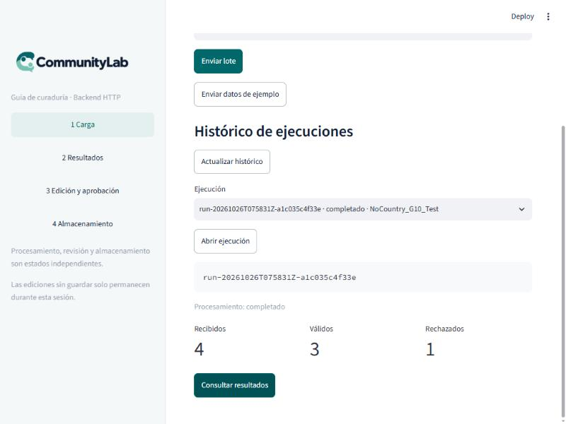
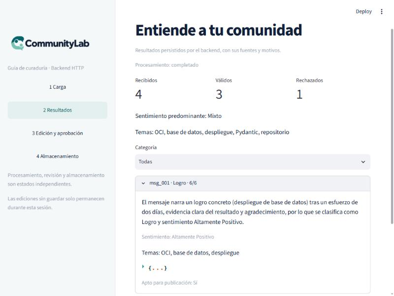
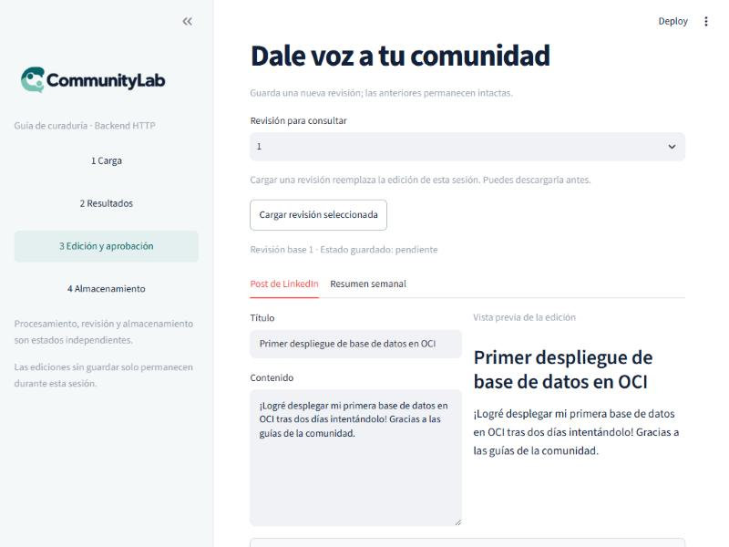
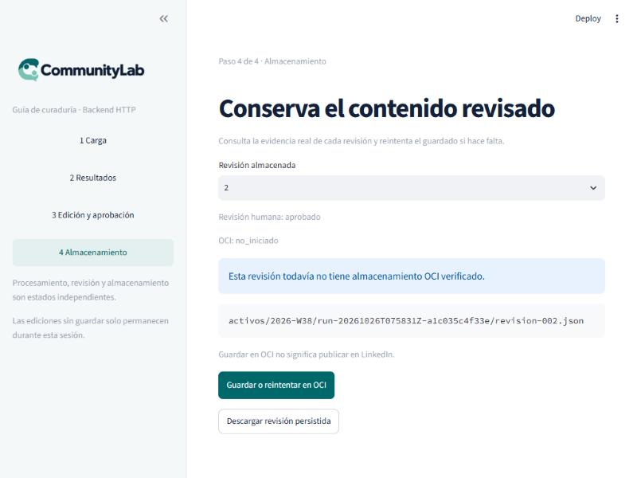
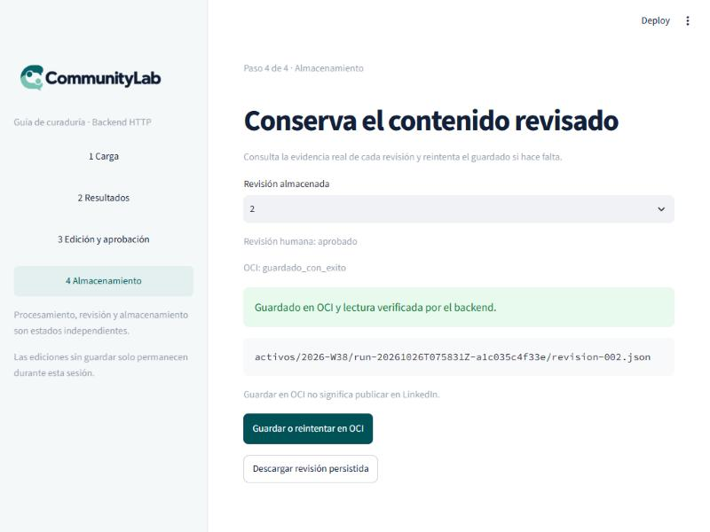

# Prueba de punta a punta con generación real de IA (Groq) y OCI del equipo

Fecha: 26 de octubre de 2026. Ejecutada por Sergio (Frontend) con datos sintéticos.
Complementa [`2026-10-25-integracion-http.md`](2026-10-25-integracion-http.md) y la prueba
del 25 de octubre (`prueba-e2e-resumen-equipo.pdf`), que dejó **sin validar la
generación de contenido con IA** porque la clave gratuita de Gemini se quedó sin cuota.

## 1. Resumen

| Pregunta | Respuesta |
|---|---|
| ¿Funciona el flujo completo panel → API → worker → IA → OCI? | ✅ Sí. El run terminó `completado` en 115 s |
| ¿El post y el resumen los escribió el modelo o la plantilla de respaldo? | ✅ **El modelo.** `degradado: false`, ningún evento `generacion_ia_degradada_a_plantilla` y texto coherente con las fuentes |
| ¿Funciona el guardado en el **bucket real del equipo**? | ✅ Sí: subida, lectura de verificación y objeto comprobado de forma independiente con el SDK de OCI |
| ¿Qué proveedor de IA se usó? | Groq, modelo `openai/gpt-oss-120b`, mediante el endpoint compatible con OpenAI |
| ¿Qué quedó en el bucket del equipo? | Nada: se borraron los 2 objetos de la prueba; los 6 objetos de otros compañeros siguen intactos |

**Aviso importante para quien repita esto:** con la configuración por defecto del proyecto
(concurrencia 5, espera de 30 s por llamada) y la capa gratuita de Groq, **el primer
intento falló parcialmente**: 2 de 3 mensajes quedaron degradados y el run terminó
`sin_contenido_publicable`. La causa es el límite de **8.000 tokens por minuto** de la capa
gratuita (ver sección 5). Con tres variables de entorno ajustadas el run completó sin
ninguna degradación.

## 2. Configuración usada

Solo variables de entorno; no se cambió código. El archivo `.env` está fuera de git y **no
se incluye ninguna clave** en este documento.

| Variable | Valor | Para qué |
|---|---|---|
| `LLM_PROVIDER` | `openai` | El proyecto trata a Groq como un endpoint compatible con OpenAI |
| `OPENAI_BASE_URL` | `https://api.groq.com/openai/v1` | Apunta el cliente a Groq (el SDK de OpenAI lee esta variable) |
| `OPENAI_MODEL` | `openai/gpt-oss-120b` | Modelo elegido tras probar tres (sección 4) |
| `OPENAI_API_KEY` | *(clave de Groq, no se muestra)* | Se llama así porque el proyecto lee ese nombre |
| `COGNITIVE_ANALYZER_CONCURRENCY` | `1` | Solo en el segundo intento: una llamada a la vez |
| `LLM_INFERENCE_TIMEOUT_SEC` | `150` | Solo en el segundo intento: el valor por defecto es 30 |
| `LLM_MAX_RETRIES` | `5` | Solo en el segundo intento: el valor por defecto es 3 |

Credenciales OCI: las de la aplicación del equipo (`OCI_USER_OCID`, `OCI_TENANCY_OCID`,
`OCI_FINGERPRINT` y la clave `.pem` en `secrets/`), región `mx-queretaro-1` y el bucket
del equipo. Antes de escribir nada se comprobó que la clave se lee, que su huella coincide
con `OCI_FINGERPRINT` y que el cliente conecta con el bucket. La carpeta `secrets/` está
excluida en `.gitignore`.

> **Esto no prueba el proveedor `openai` oficial.** Se usó el mismo código con otro
> destino. Sirve para validar el pipeline, no para afirmar nada sobre la API de OpenAI.

## 3. Piezas y aislamiento

| Pieza | Detalle |
|---|---|
| API | `uvicorn api.main:app` en un puerto local libre (8051). Código: `main` (con #28, #29 y #30) más el commit del PR #32 en el panel |
| Worker | `python -m orchestration.worker` con el mismo directorio de datos |
| Panel | Streamlit (`ui/app.py`) en el puerto 8503, que solo habla con la API por HTTP |
| Datos | `data/raw/lote_prueba_01.json`: 4 mensajes (3 válidos y 1 vacío que debe rechazarse), con un `request_id` nuevo en cada envío |
| Directorio de datos | Temporal y limpio; no se tocó `data/` del repositorio |
| OCI | Bucket del equipo. Antes de empezar se listó lo que había: 6 objetos de compañeros, ninguno bajo el periodo `2026-W38` de la prueba |

## 4. Verificación previa del proveedor

1. **Clave y modelo.** Con el modelo `llama-3.3-70b-versatile` la API respondió `404
   model_not_found`: la clave es válida pero ese modelo no está disponible en la cuenta.
2. **Modelos disponibles.** Se listaron con la propia API de Groq (`/models`). Los
   utilizables para texto eran `openai/gpt-oss-120b`, `openai/gpt-oss-20b` y
   `qwen/qwen3.8-27b`.
3. **Prueba de salida estructurada.** El proyecto necesita que el modelo devuelva un
   JSON validado contra un esquema. Se hicieron 3 llamadas a cada uno de los tres modelos
   con un esquema sencillo: **las 9 respondieron correctamente** (300 a 630 ms).
4. **Decisión.** Se eligió `openai/gpt-oss-120b`, el más capaz de los tres.

Esa prueba usaba un prompt corto. Con el prompt real del proyecto el comportamiento fue
distinto, como se ve en la sección 5.

## 5. Primer intento: configuración por defecto

Run `run-20261026T075238Z-f7204498eb15`, concurrencia 5, espera de 30 s, 3 reintentos.

| Mensaje | Resultado |
|---|---|
| `msg_001` | **Degradado** por `ModelHTTPError` tras reintentos |
| `msg_002` | **Degradado** por `TimeoutError` |
| `msg_003` | Analizado por el modelo: 4/6, no apto para publicación |
| Resultado del run | `sin_contenido_publicable`, sin paquete (83,7 s) |

El degradado funcionó como está diseñado: los dos mensajes quedaron marcados (0/6, tema
`Sin_Clasificar`, no aptos) y aparecen en las alertas de soporte. No se cayó nada, pero
tampoco había nada publicable.

### Causa

Llamando al modelo con el prompt real del proyecto y mirando las cabeceras de la
respuesta:

- El prompt del análisis tiene **19.562 caracteres, unos 4.900 tokens** (estimación de
  caracteres entre 4).
- Groq limita la capa gratuita a **8.000 tokens por minuto por modelo** (cabecera
  `x-ratelimit-limit-tokens: 8000`) y a 1.000 peticiones (`x-ratelimit-limit-requests`).
  Al hacer la comprobación quedaban 4.960 tokens disponibles tras las llamadas anteriores.
- Con cinco llamadas simultáneas, cada una con un prompt de ~4.900 tokens, se agota la
  cuota casi al instante. Llamadas de una en una tardaron 2,5 s, 47 s y 52 s.

Interpretación (no medida directamente): las esperas largas son compatibles con que el SDK
espere el tiempo indicado en `Retry-After` tras un `429`. Con una espera de 30 s por
llamada, eso se convierte en `TimeoutError`.

## 6. Segundo intento: ajustado a la cuota

Mismo lote con un `request_id` nuevo, concurrencia 1, espera de 150 s y 5 reintentos.

Run `run-20261026T075831Z-a1c035c4f33e`: **`completado`**, de la recepción al estado final
en 115 s.

| Etapa | Resultado |
|---|---|
| Validación | 3 válidos, 1 rechazado (el mensaje vacío `msg_004`) |
| Análisis | 3 mensajes analizados, **0 degradados**, 18.261 tokens de entrada y 2.111 de salida, 100,0 s (33 s por mensaje) |
| Generación | Post y resumen, **13,2 s**, 896 tokens de entrada y 551 de salida, `degradado: false` |
| Guardado en OCI (revisión 1, automático) | Subida 721 ms, lectura de verificación 167 ms, `hash_match: true` |
| Estado del run | `completado`; metadatos: `openai/gpt-oss-120b + openai/gpt-oss-120b`, 113,1 s, 21.819 tokens |

### Mensajes analizados

| Mensaje | Categoría | Puntuación | Apto | Temas |
|---|---|---|---|---|
| `msg_001` | Logro | 6/6 | Sí | OCI, base de datos, despliegue |
| `msg_002` | Logro | 5/6 | Sí | Pydantic, repositorio |
| `msg_003` | Duda | 5/6 | No | webhooks, n8n |

El modelo no es determinista: en el primer intento `msg_003` salió como «Dificultad 4/6» y
en este como «Duda 5/6». En ambos casos no apto.

## 7. ¿Es realmente texto del modelo y no la plantilla?

Es la pregunta que dejó abierta la prueba del 25 de octubre y el hallazgo C de PN-004. Hay
cuatro evidencias independientes:

1. **Log del worker:** el evento `generacion_activos_completada` trae `"degradado": false`.
2. **Ausencia del evento de respaldo:** el log del worker no contiene ningún
   `generacion_ia_degradada_a_plantilla` (0 coincidencias).
3. **Metadatos del paquete:** `modelo` registra `openai/gpt-oss-120b` en las dos etapas,
   con la versión de prompt de la generación (`generacion-1.0.1+sha256:973a5f51471e`).
4. **Contenido:** coherente con las fuentes, con datos concretos que no están en ninguna
   plantilla.

    - **Post** (cita `msg_001`): «Primer despliegue de base de datos en OCI. ¡Logré
      desplegar mi primera base de datos en OCI tras dos días intentándolo! Gracias a las
      guías de la comunidad.»
    - **Resumen** (cita `msg_001`, `msg_002` y `msg_003`): «Equipo celebra despliegue de
      base de datos en OCI y finaliza esquemas Pydantic».


Conclusión: con un proveedor con cuota suficiente, **la generación con IA funciona de
punta a punta**.

## 8. Recorrido por el panel

Run abierto desde el histórico del panel, con la API real detrás.

### Pantalla 1 · Carga

El histórico viene del backend. El run está `completado`: 4 recibidos, 3 válidos y 1
rechazado.



### Pantalla 2 · Resultados

Sentimiento «Mixto», temas reales del análisis y cada mensaje con su categoría y
puntuación. El detalle de `msg_001` muestra el motivo redactado por el modelo.



### Pantalla 3 · Edición y aprobación

El editor muestra el post generado por el modelo, no una plantilla. La revisión 1 aparece
como `pendiente`. Se escribió el nombre del revisor y se pulsó **Aprobar revisión**: el
backend creó la **revisión 2, `aprobado`, revisor «Sergio»**, y la revisión 1 quedó intacta.



### Pantalla 4 · Almacenamiento

La revisión 2 aparece con OCI `no_iniciado` (aprobar no guarda en OCI):



Tras pulsar **Guardar o reintentar en OCI**, el panel muestra «Guardado en OCI y lectura
verificada por el backend»:



## 9. Verificación independiente en OCI

El panel y el backend dicen «guardado y verificado»; además se comprobó directamente en el
bucket con el SDK de OCI, sin pasar por la aplicación:

- **Objetos:** existían exactamente dos bajo la ruta del run,
  `activos/2026-W38/<run_id>/revision-001.json` y `revision-002.json`.
- **Contenido:** se descargaron y se compararon campo a campo con el paquete que devuelve
  la API. Son **idénticos salvo un bloque**: `almacenamiento_oci` (en el objeto dice
  `no_iniciado`, y la API muestra `guardado_con_exito`).
- **Por qué esa diferencia es esperada:** el objeto se serializa antes de subirse, así
  que no puede contener su propio resultado; la API superpone el estado real. El texto
  del modelo llegó íntegro.
- **Estado de revisión dentro del objeto:** la revisión 1 `pendiente` y la 2 `aprobado`.

## 10. Limpieza

- **Bucket del equipo:** se borraron **solo** los 2 objetos de esta prueba (`revision-001`
  y `revision-002` bajo `activos/2026-W38/<run_id>/`). Comprobado después: 0 objetos
  restantes de la prueba y los **6 objetos de otros compañeros intactos**.
- **Procesos:** se pararon la API, el worker y el panel de la prueba.
- **Datos:** el directorio temporal queda fuera del repositorio.
- **`.env`:** no se versiona. Para la prueba se dejó activo el bloque de Groq y se
  comentó (sin borrar) el de OpenRouter, que tenía los mismos nombres de variable.

## 11. Hallazgos y observaciones

1. **La capa gratuita de Groq exige ajustar tres variables.** Con los valores por defecto
   del proyecto, el análisis se degrada. Para esa capa conviene:
   `COGNITIVE_ANALYZER_CONCURRENCY=1`, `LLM_INFERENCE_TIMEOUT_SEC=150`,
   `LLM_MAX_RETRIES=5`. Con una cuenta de pago, con más cuota, probablemente no haga falta
(no se probó).
2. **Una degradación por cuota se ve poco.** En el primer intento el run terminó
   `sin_contenido_publicable` y no `fallido`; la causa (cuota) solo se ve en las alertas
   de soporte y en el log. Quien mire únicamente el estado del run no sabría que el modelo
   estaba limitado.
3. **El proveedor por defecto es inconsistente.** `.env.example` dice `gemini`, pero el
   código usa `openai` si `LLM_PROVIDER` no está definido (`ai_modules/cognitive_analyzer.py`
   y `ai_modules/generador.py`).
4. **Refuerza la propuesta de PN-004 (marcar la degradación en el paquete).** El worker
   ya calcula `degradado` y lo escribe en el log (`false` aquí). Ese dato **no** llega al
   paquete que ve quien revisa. Incluirlo en `MetadatosEjecucion` sería barato, pero
   toca el contrato de datos (`esquemas.py`) y necesita consenso del equipo.
5. **El worker guarda la revisión 1 en OCI automáticamente** al terminar el run. Las
   revisiones posteriores (aprobación, edición) se guardan con el botón del panel.
6. **La API de evidencia OCI no devuelve los hashes.** Hay que comprobar el contenido
   aparte, como se hizo en la sección 9.
7. **Botón «Enviar datos de ejemplo».** La limitación anotada en PN-001 (el `request_id`
   fijo del archivo de ejemplo devuelve siempre el mismo run) la resuelve el PR #32 con un
   sufijo de tiempo. En esta prueba **no se pulsó el botón**: los dos lotes se enviaron por
   script con esa misma lógica y dieron dos runs con dos `request_id` distintos
   (`req-prueba-001_1793001158` y `req-prueba-001_1793001511`). El comportamiento del botón
   lo cubre el test `test_example_batch_uses_unique_request_id_each_time` del PR #32.

## 12. Limitaciones

- Un solo run completo, con 3 mensajes sintéticos. No es una prueba de carga ni de
  calidad editorial.
- El modelo no es determinista; otro intento puede dar otras puntuaciones.
- Los tiempos dependen de la cuota de la cuenta de Groq en ese momento.
- No se ejercitó OpenRouter (se añadió la clave, pero esta prueba usó solo Groq) ni los
  proveedores `anthropic` u `openai` oficiales.
- Los fallos de OCI y de modelo ya quedaron documentados en
  `pruebas-negativas-pn003-pn004.md` (PR #31); esta prueba es el caso feliz con generación
  real.

## 13. Cómo repetirlo

```powershell
# 1. En .env: LLM_PROVIDER=openai, OPENAI_BASE_URL=https://api.groq.com/openai/v1,
#    OPENAI_MODEL=openai/gpt-oss-120b y OPENAI_API_KEY=<tu clave de Groq>
# 2. Variables para la capa gratuita y un directorio de datos limpio:
$env:COMMUNITYLAB_DATA_DIR = "<directorio-vacio>"
$env:COMMUNITYLAB_WEBHOOK_SECRET = "<secreto-local-de-16-o-mas-caracteres>"
$env:COGNITIVE_ANALYZER_CONCURRENCY = "1"
$env:LLM_INFERENCE_TIMEOUT_SEC = "150"
$env:LLM_MAX_RETRIES = "5"

# 3. API, worker y panel (cada uno en su terminal)
uv run --frozen uvicorn api.main:app --host 127.0.0.1 --port 8051
uv run --frozen python -m orchestration.worker
$env:COMMUNITYLAB_API_URL = "http://127.0.0.1:8051"
uv run --frozen streamlit run ui/app.py --server.port 8503
```

Con la clave de OCI en `secrets/` y las variables `OCI_*` activas, el worker guardará
la revisión 1 en el bucket configurado. **Si usas el bucket del equipo, borra después solo
los objetos de tu run** (`activos/<periodo>/<tu run_id>/`).
