# Prueba de punta a punta con configuración por defecto (OpenRouter → `gpt-4o-mini`) y panel completo

Fecha: 26 de octubre de 2026. Ejecutada por Sergio (Frontend) con datos sintéticos.
Cierra las pruebas del día junto con
[`2026-10-26-e2e-groq-generacion-real.md`](2026-10-26-e2e-groq-generacion-real.md) y
[`pruebas-negativas-pn001-pn002.md`](pruebas-negativas-pn001-pn002.md) /
[`pruebas-negativas-pn003-pn004.md`](pruebas-negativas-pn003-pn004.md).

## 1. Resumen

| Pregunta | Respuesta |
|---|---|
| ¿Funciona el proyecto **con su configuración por defecto** (sin ajustar concurrencia ni tiempos)? | ✅ Sí. Dos runs completos, **0 mensajes degradados**, de 6 a 7 s cada uno |
| ¿Funciona en vivo el botón «Enviar datos de ejemplo» (PR #32)? | ✅ Sí. Dos pulsaciones seguidas crearon **dos runs distintos** (`request_id` distintos) |
| ¿El contenido lo generó el modelo y no la plantilla? | ✅ Sí. `degradado: false` en los dos runs y ningún evento de plantilla |
| ¿Funciona el ciclo de revisión humana (editar, guardar, aprobar)? | ✅ Sí: 3 revisiones encadenadas, con revisor y comentario |
| ¿Funciona el guardado en el bucket del equipo? | ✅ Sí, y se verificó el contenido en OCI de forma independiente |
| ¿Se probó la **API oficial de OpenAI**? | ❌ **No.** La cuenta no tenía saldo (sección 2). Esta prueba usó **OpenRouter**, que enruta a `openai/gpt-4o-mini` |
| ¿Quedó algo en el bucket del equipo? | No: se borraron los 3 objetos de la prueba; los 6 de otros compañeros siguen intactos |

**Aviso:** esta prueba **no valida el proveedor `openai` oficial**. Valida el mismo código
con un endpoint compatible. La prueba contra la API de OpenAI sigue pendiente de que la
cuenta tenga saldo.

## 2. Por qué OpenRouter y no OpenAI

Con la clave de OpenAI puesta en el `.env` y sin `OPENAI_BASE_URL`, las llamadas llegaron a
OpenAI y fueron rechazadas:

- Código HTTP `429`, tipo `insufficient_quota`, código `credit_balance_exhausted`.
- Mensaje: «You have no credits remaining».
- Se reprodujo con las tres llamadas de prueba y con una petición directa a la API.

La clave era válida; faltaba saldo en la cuenta. No se arrancó el recorrido, porque habría
terminado degradado por esa causa y no por el sistema. Se activó entonces el bloque de
OpenRouter que ya estaba en el `.env`.

## 3. Configuración usada

Solo variables de entorno; no se cambió código. El `.env` está fuera de git y **no se
incluye ninguna clave** en este documento.

| Variable | Valor |
|---|---|
| `LLM_PROVIDER` | `openai` (el proyecto trata a OpenRouter como un endpoint compatible con OpenAI) |
| `OPENAI_BASE_URL` | `https://openrouter.ai/api/v1` |
| `OPENAI_MODEL` | `openai/gpt-4o-mini` |
| `OPENAI_API_KEY` | *(clave de OpenRouter, no se muestra)* |
| `COGNITIVE_ANALYZER_CONCURRENCY`, `LLM_INFERENCE_TIMEOUT_SEC`, `LLM_MAX_RETRIES` | **Sin definir**: se usan los valores por defecto del proyecto (concurrencia 5, espera de 30 s, 3 reintentos) |

Credenciales OCI: las de la aplicación del equipo, región `mx-queretaro-1` y bucket del
equipo, con la clave en `secrets/` (excluida por `.gitignore`).

## 4. Piezas y aislamiento

| Pieza | Detalle |
|---|---|
| Código | `main` actualizado con los PR #28, #29, #30, #31 y #32 |
| API | `uvicorn api.main:app` en el puerto 8052 |
| Worker | `python -m orchestration.worker`, con los valores por defecto |
| Panel | Streamlit (`ui/app.py`) en el puerto 8504 |
| Datos | `data/raw/lote_prueba_01.json`: 4 mensajes (3 válidos y 1 vacío que debe rechazarse), enviado **desde el botón del panel** |
| Directorio de datos | Temporal y limpio; no se tocó `data/` del repositorio |
| OCI | Bucket del equipo. Antes de empezar se listó: 6 objetos de compañeros, los mismos que al final |

Verificación previa del proveedor: tres llamadas con salida estructurada a `openai/gpt-4o-mini`
vía OpenRouter respondieron correctamente (1,1 a 2,3 s).

## 5. Paso 1: el botón «Enviar datos de ejemplo» (validación en vivo del PR #32)

Se pulsó el botón **dos veces** con unos 10 segundos de diferencia. Antes del PR #32 el
segundo envío habría recuperado el run anterior, porque el `request_id` del archivo de
ejemplo es fijo.

| Pulsación | `request_id` | Run | Mensaje del panel |
|---|---|---|---|
| 1.ª | `req-prueba-001_1793003089` | `run-20261026T082449Z-0cfbee923c77` (run A) | «Lote recibido por el backend» |
| 2.ª | `req-prueba-001_1793003099` | `run-20261026T082459Z-050c1705700a` (run B) | «Lote recibido por el backend» |

En ninguna de las dos apareció «Se recuperó la ejecución existente».

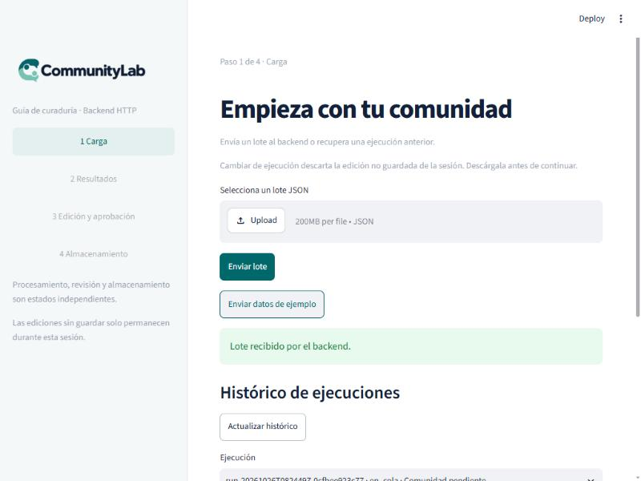
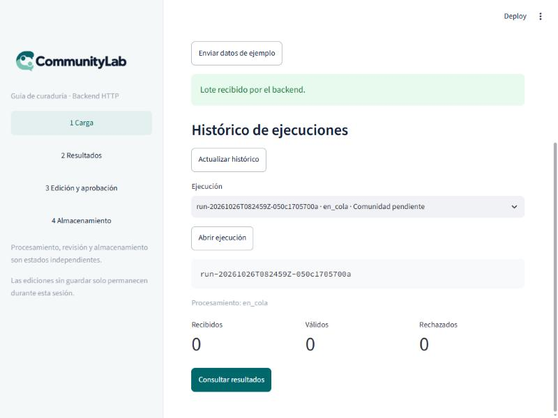

## 6. Paso 2: el pipeline con la configuración por defecto

Los dos runs terminaron `completado` solos, sin intervención.

| Dato | Run A | Run B |
|---|---|---|
| Tiempo total (recepción → completado) | 7,1 s | 6,0 s |
| Análisis (3 mensajes) | 3,6 s | 2,8 s |
| Mensajes degradados | 0 | 0 |
| Tokens del análisis (entrada / salida) | 18.201 / 446 | 18.201 / 445 |
| Tokens cacheados en el análisis | 11.776 | 18.048 |
| Generación (post + resumen) | 1,8 s | 1,7 s |
| Tokens de la generación (entrada / salida) | 713 / 221 | 715 / 205 |
| Flag `degradado` de la generación | `false` | `false` |
| OCI: subida de la revisión 1 (automática) | 640 ms | 158 ms |
| OCI: lectura de verificación | 159 ms, `hash_match: true` | 149 ms, `hash_match: true` |
| Tokens totales (metadatos del paquete) | 19.581 | 19.566 |

El worker no emitió ningún evento `inferencia_degradada` ni
`generacion_ia_degradada_a_plantilla` (0 en total).

### Mensajes analizados

| Mensaje | Run A | Run B |
|---|---|---|
| `msg_001` | Logro, 6/6, apto | Logro, 6/6, apto |
| `msg_002` | Logro, 6/6, apto | Logro, **4/6**, apto |
| `msg_003` | Duda, 1/6, no apto | Duda, 1/6, no apto |

La misma entrada dio una puntuación distinta en `msg_002` entre los dos runs: el modelo no
es determinista. `msg_004` (vacío) se rechazó en la validación, como debe.

## 7. Paso 3: textos generados

| | Post de LinkedIn | Resumen semanal (titular) |
|---|---|---|
| **Run A** | «Mi primer despliegue en OCI. ¡Logré desplegar mi primera base de datos en OCI tras dos días intentándolo! Gracias a las guías de la comunidad, he podido aprender y aplicar nuevos conocimientos en un entorno real. Esta experiencia ha sido un gran paso en mi carrera y estoy emocionado por lo que vendrá a continuación.» | «Avances destacados de la semana en la comunidad» |
| **Run B** | «Primer Despliegue en OCI. ¡Logré desplegar mi primera base de datos en OCI tras dos días intentándolo! Gracias a las guías de la comunidad.» | «Inicio de proyectos exitosos en OCI y Pydantic» |

Mensaje original (`msg_001`): «¡Logré desplegar mi primera base de datos en OCI tras dos
días intentándolo! Gracias a las guías de la comunidad.»

**Hallazgo:** el post del run A **añade afirmaciones que no están en el mensaje original**
(«he podido aprender y aplicar nuevos conocimientos en un entorno real», «un gran paso en mi
carrera», «estoy emocionado por lo que vendrá»). El del run B reproduce el original sin
añadir nada. Es una sola observación y el modelo no es determinista, pero muestra que **la
revisión humana es necesaria**: el modelo puede inventar contenido que parece plausible, y
ese texto quedaría atribuido a un miembro de la comunidad.

## 8. Paso 4: recorrido por el panel (run B)

### Resultados

Sentimiento «Mixto», temas del análisis y cada mensaje con su categoría y puntuación.

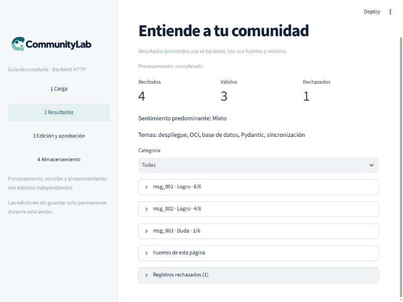

El detalle de `msg_003` (Duda, 1/6) muestra el motivo redactado por el modelo.

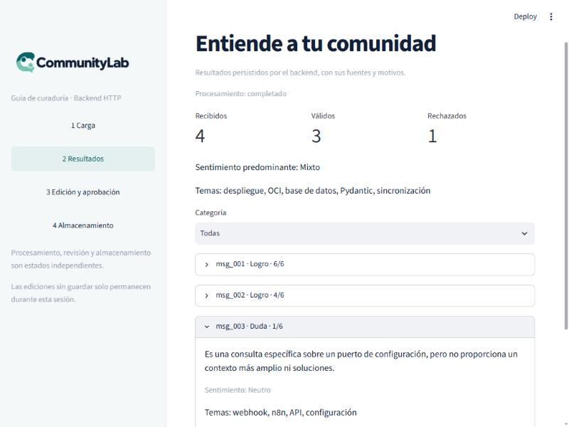

### Edición y aprobación

El editor muestra la revisión 1, generada por el modelo y todavía `pendiente`.

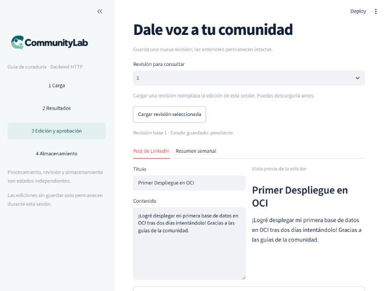

Se amplió el cuerpo del post con una frase propia. La vista previa se actualizó al instante.

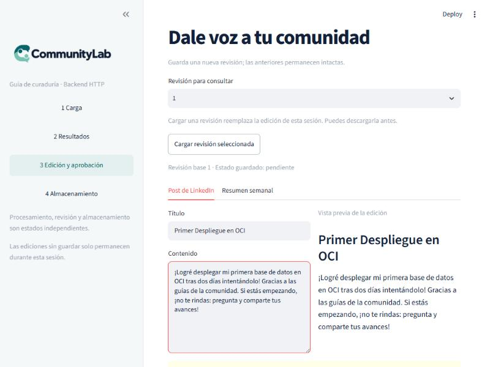

Mientras hay cambios sin guardar, el panel avisa de que **la aprobación de la revisión base
no se aplica a esos textos**.

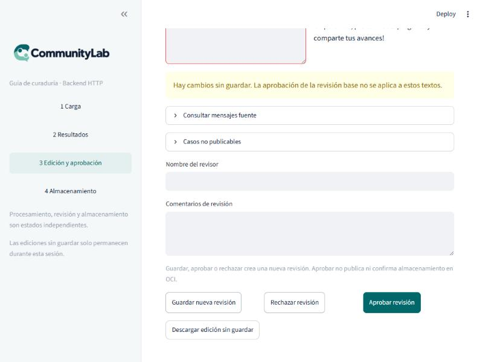

Se pulsó **Guardar nueva revisión**: nació la **revisión 2, `pendiente`**, con el texto
editado y sin tocar la revisión 1.

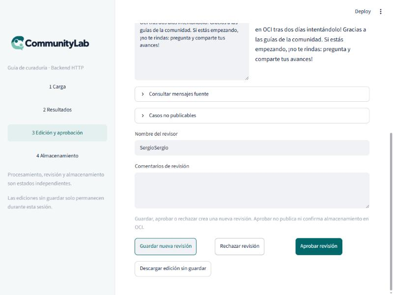

Con el revisor «Sergio» y el comentario «Texto ajustado a mano; contenido de prueba con
datos sintéticos.», se pulsó **Aprobar revisión**: nació la **revisión 3, `aprobado`**. El
panel muestra «Revisión base 3 · Estado guardado: aprobado».

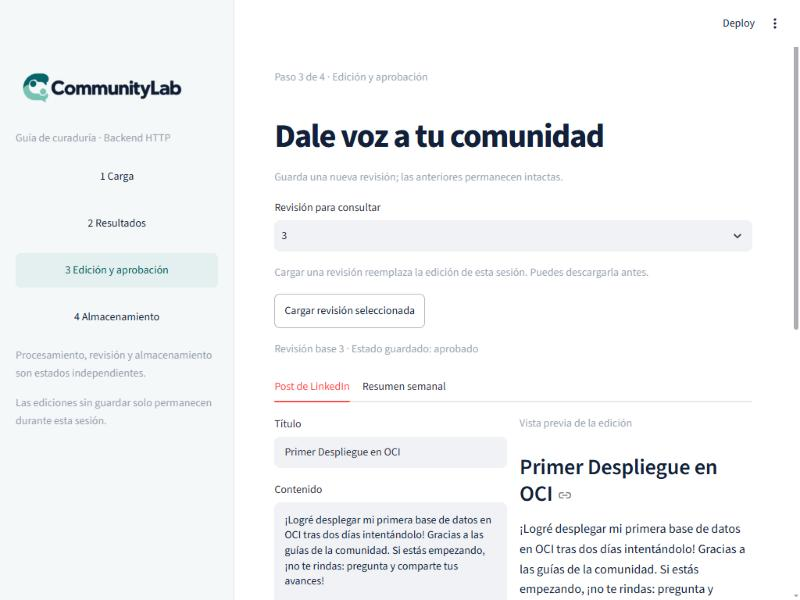

**Historial resultante del run B**

| Revisión | Estado | Origen | OCI |
|---|---|---|---|
| 1 | `pendiente` | Generada por el modelo | Guardada por el worker, automáticamente |
| 2 | `pendiente` | Edición del revisor | `no_iniciado` (no se guardó) |
| 3 | `aprobado` | Aprobada por «Sergio», con comentario | Guardada desde el panel |

**Detalle a anotar:** la revisión 2 quedó con el revisor `SergioSergio`. Es un artefacto de
cómo se introdujo el dato en la prueba automatizada (la primera escritura se aplicó aunque
el campo se veía vacío, y la segunda se concatenó), no un fallo del panel. Se corrigió
antes de aprobar y la revisión 3 consta como «Sergio».

### Almacenamiento

La revisión 3 aparece con OCI `no_iniciado`: aprobar no guarda en OCI.

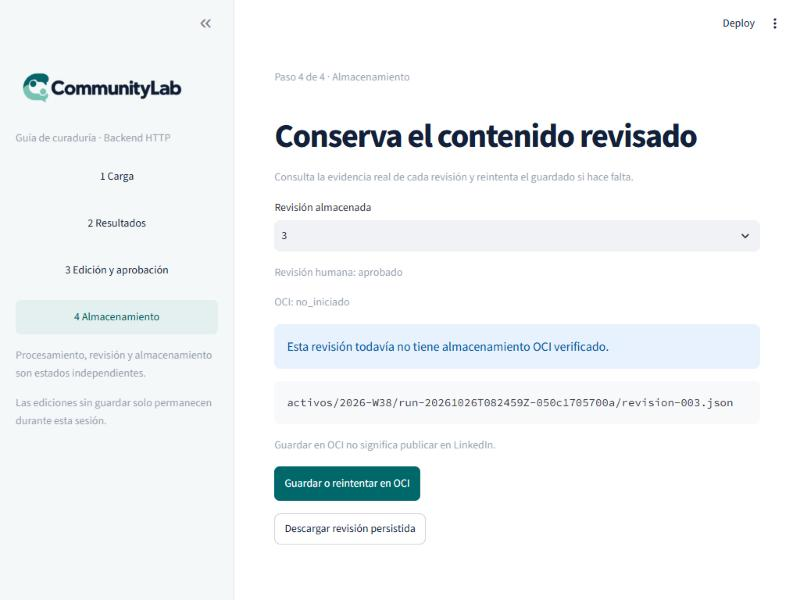

Tras **Guardar o reintentar en OCI**: «Guardado en OCI y lectura verificada por el backend».

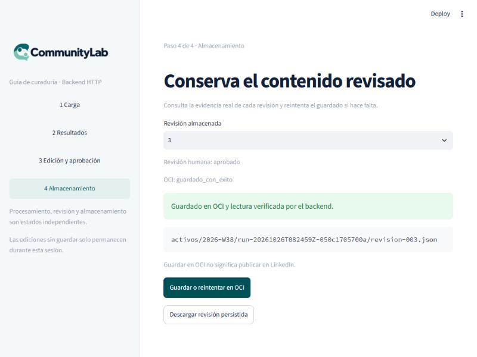

## 9. Verificación independiente en OCI

Se comprobó directamente en el bucket con el SDK de OCI, sin pasar por la aplicación:

- **Objetos:** exactamente tres de mis runs: la revisión 1 del run A, y las revisiones 1 y 3
  del run B. La revisión 2 **no** existe en OCI, porque no se guardó, como debe ser.
- **Contenido:** cada objeto se comparó con el paquete que devuelve la API: son
  **idénticos salvo el bloque `almacenamiento_oci`** (que el objeto lleva en `no_iniciado`
  porque se serializa antes de subirse, y la API superpone el estado real), igual que en la
  prueba de Groq.
- **Estado de la revisión dentro de cada objeto:** `pendiente`, `pendiente` y `aprobado`.

## 10. Limpieza

- **Bucket del equipo:** se borraron **solo** los 3 objetos de esta prueba. Comprobado
  después: 0 objetos restantes de mis runs y los **6 de otros compañeros intactos**
  (los mismos que al empezar).
- **Procesos:** se pararon la API, el worker y el panel de la prueba.
- **`.env`:** no se versiona. Se dejó activo el bloque de OpenRouter y comentados, sin
  borrar, los de Groq y OpenAI oficial.

## 11. Comparativa de las tres pruebas con IA real

| | Gemini (25 oct) | Groq `gpt-oss-120b` (26 oct) | OpenRouter `gpt-4o-mini` (26 oct) |
|---|---|---|---|
| Configuración | Por defecto + modelo fijado | Por defecto: **falló**. Ajustada (concurrencia 1, 150 s, 5 reintentos): ✅ | **Por defecto**: ✅ |
| Análisis con el modelo | ✅ | ✅ (tras ajustar) | ✅ |
| Generación con el modelo | ❌ cuota `429`, cayó a plantilla | ✅ | ✅ |
| Tiempo del run | n/a | 115 s | 6 a 7 s |
| Mensajes degradados | no se cuantificó | 2 de 3 con la configuración por defecto; 0 tras ajustar | 0 |
| Causa del problema | Cuota de la capa gratuita | 8.000 tokens/min de la capa gratuita | — |
| OCI | Bucket de prueba personal | Bucket del equipo ✅ | Bucket del equipo ✅ |

La diferencia entre Groq y OpenRouter no es del código del proyecto: es la **cuota de la
cuenta**. Con cuota suficiente, los valores por defecto funcionan bien.

## 12. Hallazgos y observaciones

1. **El PR #32 funciona en vivo.** Dos pulsaciones del botón crearon dos runs distintos.
2. **Los valores por defecto del proyecto son adecuados con un proveedor con cuota.**
   Los ajustes de concurrencia y tiempo solo hicieron falta con la capa gratuita de Groq.
3. **El modelo puede inventar contenido** (sección 7). Refuerza que la aprobación humana
   no es un trámite. Una restricción más explícita en el prompt de generación («no añadir
   hechos que no estén en las fuentes») podría reducirlo; no se probó ni se modificó nada.
4. **La API oficial de OpenAI sigue sin probarse** por falta de saldo en la cuenta.
5. **El nombre del modelo en los metadatos es el de OpenRouter** (`openai/gpt-4o-mini`),
   no el de OpenAI directo (`gpt-4o-mini`). Quien lea un paquete no podrá distinguir si
   la llamada fue a OpenAI o a un intermediario; solo `OPENAI_BASE_URL` lo determina.
6. **Los tokens cacheados** (11.776 y 18.048 de 18.201 en el análisis) indican que el caché
   de prefijo del prompt funciona a través de OpenRouter. No se comparó con OpenAI directo.
7. **Sigue pendiente, por consenso del equipo,** la propuesta de PN-004: llevar el flag
   `degradado` de la generación al paquete (hoy solo está en el log). Aquí era `false`.

## 13. Limitaciones

- Dos runs completos, con 3 mensajes sintéticos. No es una prueba de carga ni de calidad
  editorial.
- El modelo no es determinista; otra ejecución puede dar otras puntuaciones y otros textos.
- El proveedor intermediario puede enrutar a distintos backends; no se verificó cuál sirvió
  las llamadas.
- Los tiempos dependen del proveedor y de la red en ese momento.
- No se ejercitaron los proveedores `anthropic` ni `openai` oficial.
- Los fallos de OCI y del modelo se documentan en las pruebas negativas PN-003 y PN-004.

## 14. Cómo repetirlo

```powershell
# 1. En .env: LLM_PROVIDER=openai, OPENAI_BASE_URL=https://openrouter.ai/api/v1,
#    OPENAI_MODEL=openai/gpt-4o-mini y OPENAI_API_KEY=<tu clave de OpenRouter>
#    (para OpenAI oficial: quitar OPENAI_BASE_URL y usar OPENAI_MODEL=gpt-4o-mini)
# 2. Directorio de datos limpio y secreto local; no definir las variables de ajuste:
$env:COMMUNITYLAB_DATA_DIR = "<directorio-vacio>"
$env:COMMUNITYLAB_WEBHOOK_SECRET = "<secreto-local-de-16-o-mas-caracteres>"

# 3. API, worker y panel (cada uno en su terminal)
uv run --frozen uvicorn api.main:app --host 127.0.0.1 --port 8052
uv run --frozen python -m orchestration.worker
$env:COMMUNITYLAB_API_URL = "http://127.0.0.1:8052"
uv run --frozen streamlit run ui/app.py --server.port 8504
```

Después, en el panel: «Enviar datos de ejemplo» y recorrer las cuatro pantallas. Si se usa
el bucket del equipo, **borrar solo los objetos del propio run**
(`activos/<periodo>/<run_id>/`).
