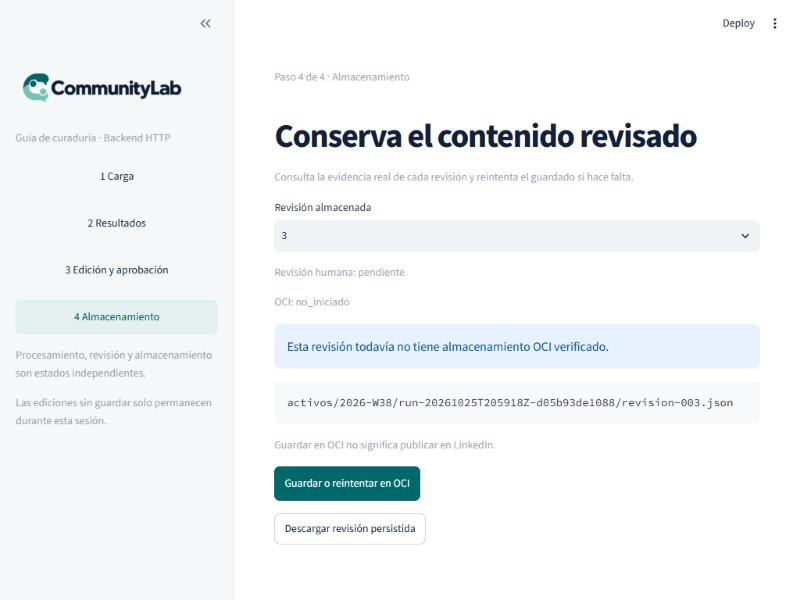
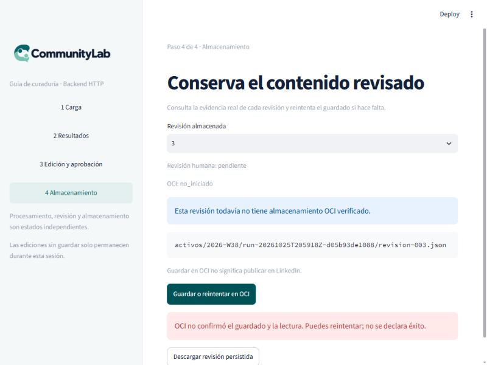
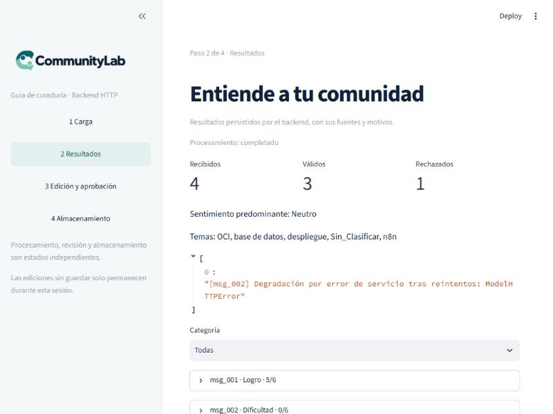

# Pruebas negativas PN-003 y PN-004 · fallo de OCI y fallo del modelo

Fecha: 25 de octubre de 2026. Issue relacionado: HU-S1-006 (#10), sección
«Pruebas negativas y de resiliencia». Complementa
[`pruebas-negativas-pn001-pn002.md`](pruebas-negativas-pn001-pn002.md).

## Resumen

| Prueba | Resultado |
|---|---|
| **PN-003 · Fallo de OCI** | ✅ Cumple: el fallo se detecta, queda persistido como `guardado_error` con `comprobacion_lectura: false` y **nunca** se declara éxito |
| **PN-004 · Fallo del modelo de IA** | ⚠️ **Cumple en el análisis, no del todo en la generación.** Un fallo en el análisis queda marcado y visible; si falla la generación, el pipeline continúa con una plantilla de respaldo **sin ninguna marca en el paquete** |

Los dos fallos son **reales**, no simulados:

- PN-003: se provocó apuntando a un bucket que ya no existe (OCI responde `404`).
- PN-004: ocurrió de forma natural durante la prueba de punta a punta (cuota `429`,
  `503` y *timeouts* de Gemini con una clave de capa gratuita).

Datos sintéticos; bucket de prueba personal, no el del equipo.

## PN-003 · Fallo de OCI

Objetivo del issue: controlar un fallo de almacenamiento, confirmar que el sistema
lo detecta y **que no se registre falsamente una operación exitosa**.

### Cómo se provocó

Se creó una revisión nueva (la 3, `pendiente`) sobre un run completado y se pulsó
«Guardar o reintentar en OCI» en el panel. El bucket de prueba ya se había borrado,
así que `put_object` falló de verdad.

### Resultados

| Capa | Qué se observó |
|---|---|
| **OCI** | `404` en `put_object` («el bucket no existe o no hay autorización»), 10 ms (evento `oci_put_object_failed`) |
| **Panel** | «OCI no confirmó el guardado y la lectura. Puedes reintentar; no se declara éxito.» No aparece el aviso verde de éxito |
| **API** `POST …/revisiones/3/oci` | `HTTP 200` con `status_almacenamiento: "guardado_error"`, `comprobacion_lectura: false` y `mensaje_error` con el texto de OCI |
| **Persistencia** | La revisión 3 queda `guardado_error` / `comprobacion_lectura: false` en `listar_revisiones` y en `obtener_revision` |
| **Reintento** | Vuelve a fallar con el mismo resultado; no aparece un éxito falso |
| **Separación de estados** | La revisión humana sigue `pendiente`: el fallo de OCI no altera la revisión |

**Conclusión PN-003:** el fallo se detecta, se persiste con honestidad y se puede
reintentar. Cumple el criterio.

### Observaciones

1. **`HTTP 200` con `guardado_error`.** El fallo de OCI no se señala con un código de
   error HTTP; el cliente debe leer el cuerpo. El panel lo hace y hay una prueba que
   lo cubre (`test_oci_200_error_is_not_success`, en `tests/test_ui_http_flow.py`),
   pero cualquier otro cliente de la API que mire solo el código HTTP lo tomaría
   por éxito.
2. **`mensaje_error` expone el nombre del bucket y el *namespace* de OCI** en la
   respuesta de la API (detrás del secreto compartido). El panel no lo muestra.
   Conviene valorar si esa información debe salir de la API.
3. **Texto obsoleto en el panel tras el fallo.** Justo después de fallar, la pantalla
   sigue mostrando «OCI: no_iniciado» y «Esta revisión todavía no tiene almacenamiento
   OCI verificado» junto al mensaje de error, aunque el backend ya guardó
   `guardado_error`. Se corrige al volver a abrir la pantalla. Es un detalle de
   presentación del panel, no de datos.
4. **El backend no revalida el almacenamiento después de guardar.** Las revisiones 1 y 2
   siguen en `guardado_con_exito` aunque sus objetos se borraron al limpiar el bucket
   de prueba. Es el comportamiento esperado (la evidencia se fija al guardar), pero
   conviene tenerlo presente.
5. **No se probó aquí la recuperación** tras restablecer el bucket; la cubren
   pruebas automáticas (`test_reintento_idempotente_mismo_contenido` en
   `tests/test_oci_client.py` y los casos de reintento de `tests/test_revisiones.py`).

## PN-004 · Fallo del modelo de IA

Objetivo del issue: ante una respuesta inválida o un error del modelo, verificar el
manejo controlado y **evitar que una respuesta inválida continúe silenciosamente por el
pipeline**.

Se observaron tres situaciones distintas:

### A) Falla el análisis de un mensaje → ✅ queda marcado y visible

Run con 3 mensajes válidos, donde el modelo falló solo para `msg_002`:

- Ese mensaje queda con `motivo_seleccion` «Degradación por error de servicio tras
  reintentos: ModelHTTPError», `regla_aplicada` «Degradación elegante por
  indisponibilidad de inferencia», puntuación 0/6, tema `Sin_Clasificar` y
  `apto_para_publicacion = 0`.
- Aparece en las **alertas de soporte** del resumen, y el panel lo muestra.
- Los demás mensajes del lote se analizan con normalidad.

### B) Fallan todos los mensajes → ✅ el run termina `fallido` y no genera nada

- Estado del run: `fallido` (`categoria_estado: fallida`, `tiene_paquete: false`).
- `listar_revisiones`: `disponible: false`, `motivo: sin_paquete`, sin revisiones.
- El worker registra `run_fallido_por_el_pipeline` con el error
  «inferencia no disponible: Degradación por error de servicio tras reintentos».
- No se llega a la generación ni a OCI; no se publica nada.

### C) Falla la generación → ⚠️ continúa con una plantilla, sin marca en el paquete

- El generador cae a una **plantilla de respaldo** (evento
  `generacion_ia_degradada_a_plantilla`). Es un comportamiento intencionado, con
  prueba propia (`test_timeout_por_inferencia_degrada_a_plantilla_sin_bloquear`).
- **Pero el paquete que llega a revisión no lo indica.** Se comprobó en los datos
  persistidos: `metadatos_ejecucion.modelo` dice `gemini-3.5-flash` y no existe
  ningún campo ni texto que señale que el contenido es una plantilla. La única
  constancia es el log del worker (`degradado=True`).
- Resultado: el post y el resumen quedan «pendientes de revisión humana» como
  cualquier contenido real, y quien revisa no puede distinguir una plantilla de un
  texto del modelo.

**Conclusión PN-004:** el manejo es controlado en el análisis (A y B), pero en la
generación (C) el criterio «evitar que continúe silenciosamente» **no se cumple del
todo**: no se rompe nada, pero la degradación no es visible para el revisor.

### Propuesta (requiere consenso del equipo)

Registrar la degradación en el paquete, por ejemplo con un indicador
`generacion_degradada` en `MetadatosEjecucion`, o marcando el modelo como
«plantilla», y mostrarlo en la pantalla de edición. Tocaría el contrato de datos
(`esquemas.py`), que requiere consenso del equipo, por lo que **no se modificó aquí**.

## Correspondencia con los criterios del issue #10

- [x] Se comprueba el comportamiento ante fallo OCI (PN-003).
- [x] Se comprueba el comportamiento ante fallo del modelo (PN-004), con la
  salvedad C.
- [x] No se registra falsamente una operación exitosa en OCI.
- [ ] Una respuesta inválida del modelo no continúa silenciosamente: **cumple en
  análisis, pendiente en generación**.

## Pruebas automáticas que ya cubren lo mismo

`tests/test_cognitive_analyzer_unit.py`: `test_agotamiento_degrada_sin_romper_lote`,
`test_degradacion_parcial_queda_visible_en_alertas_soporte`,
`test_un_socket_colgado_se_degrada_por_timeout_y_no_retiene_el_lote`.
`tests/test_generador.py`: `test_timeout_por_inferencia_degrada_a_plantilla_sin_bloquear`.
`tests/test_revisiones.py`: `test_estado_exito_requiere_lectura_verificada`.

Esta evidencia las complementa con ejecuciones reales de punta a punta (panel, API,
worker, Gemini y OCI).

## Limitaciones

- Los fallos de modelo vinieron de una clave de capa gratuita (cuota). Con una clave
  con cuota suficiente podrían no reproducirse; para repetir PN-004 a propósito se
  puede forzar con una clave inválida o un modelo inexistente en `GEMINI_MODEL`.
- PN-003 se provocó con un bucket inexistente. Otros fallos de OCI (permisos,
  red, hash que no coincide al leer) no se ejercitaron en vivo.
